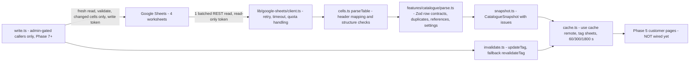

# Phase 4 Report — Google Sheets integration and data foundation

Date: 2026-11-18 · Status: **built and verified against mocks only — live Google connectivity has NOT been tested** (no credentials or spreadsheet were available). Awaiting owner review. Phase 5 not started.

## 1. Architecture and data flow

- **No new dependencies.** Sheets REST v4 over `fetch`; the service-account JWT is signed with Node `crypto`; Zod validates.
- Read path: one request for all four worksheets → header validation → row parsing (Zod) → cross-row checks → `CatalogueSnapshot { products, categories, brands, settings, issues, stats, fetchedAt }`.
- The customer site does **not** use any of this yet (Phase 3 sample data is unchanged; a test enforces it).

## 2. Files

**Created** — `src/lib/google-sheets/`: `errors.ts, config.ts, jwt.ts, auth.ts, http.ts, client.ts, worksheets.ts, cells.ts, test-utils.ts` (+ `config/auth/client/cells` tests). `src/features/catalogue/`: `types.ts, constants.ts, schemas.ts, parse.ts, snapshot.ts, cache.ts, invalidate.ts, public.ts, write.ts, write-errors.ts` (+ `parse/snapshot/cache/write/security/template` tests). `src/features/products/stock.ts`. `src/app/dev/sheets/{page,diagnostics}.tsx` (dev-only). `docs/ENVIRONMENT.md`, `docs/GOOGLE_SHEETS_SETUP.md`, `docs/sheets-template/*.csv`, `docs/PHASE_4_REPORT.md`.
**Modified** — `src/lib/errors.ts` (+`CONFLICT` 409), `src/lib/env/server.ts` (+`GOOGLE_SHEETS_PRICE_HISTORY`), `src/components/ui/status-badge.tsx` (stock constants moved to `features/products/stock.ts`, re-exported), `docs/PROJECT_BLUEPRINT.md` (statuses, decisions 41–45, gaps G30–G34).
**Not modifiable here** — `.env.example` (protected in the sandbox): the block to append is in `docs/ENVIRONMENT.md`.

## 3. Environment variables

`GOOGLE_SERVICE_ACCOUNT_EMAIL`, `GOOGLE_PRIVATE_KEY`, `GOOGLE_SHEET_ID` (required for Sheets), `GOOGLE_SHEETS_PRICE_HISTORY` (optional). Server-only; validated by name-only error reporting. See `docs/ENVIRONMENT.md`.

## 4. Worksheets and contracts

Exactly the blueprint columns (§14.2) plus optional `unit_custom` (CUSTOM unit display label). Columns are matched by header name. Rules, severities and messages: `docs/GOOGLE_SHEETS_SETUP.md` §2. Canonical units (13), `TON` ≠ `METRIC_TON`, `CUSTOM` needs a label, four stock statuses.

## 5. Data-integrity policy (how invalid rows are handled)

| Problem                                                                             | Result                                                                              |
| ----------------------------------------------------------------------------------- | ----------------------------------------------------------------------------------- |
| Missing/blank worksheet, missing or duplicate headers, > 5000 rows                  | **Whole read fails** (clear message). Never an empty catalogue                      |
| Header-only worksheet                                                               | Valid, empty                                                                        |
| Missing required value, bad slug/id/sku/unit/stock/boolean, `CUSTOM` without label  | Row **excluded**, issue `error` with worksheet/row/column                           |
| Duplicate product/category/brand id, slug, or SKU                                   | **All rows in the group** excluded and reported (which one is right is unknowable)  |
| Unknown category/brand; active product → inactive category/brand                    | Row excluded                                                                        |
| Invalid/non-positive price, bad date, image URL, specifications JSON, display order | **Field dropped** (null/[]), row kept, issue `warning`. Price is never coerced to 0 |
| Invalid/unknown/duplicate setting                                                   | Setting ignored, reported                                                           |

One malformed record never affects the others; issues are returned with the snapshot and logged (first 20), without credentials.

## 6. Caching and reliability

- `"use cache: remote"` + `cacheTag("sheets")` + `cacheLife({ stale: 60, revalidate: 300, expire: 1800 })`: shared, persistent platform cache (plain `use cache` is per-instance in-memory on serverless and was rejected). Max acceptable staleness = 30 min.
- Failures **throw** (never cached, never replaced by fake data); callers must show "unavailable". Empty (header-only) ≠ failed.
- Invalidation after writes: `updateTag` (Server Actions) → fallback `revalidateTag(tag, { expire: 0 })` → never throws (cache then expires on schedule).
- HTTP: 6 s per-attempt timeout, 2 retries, exponential backoff + jitter, `Retry-After`, 15 s total deadline; retried: 429/500/502/503/504 and network errors. Updates are idempotent (retried); **appends are not retried** on timeout/5xx (could duplicate) — only on 429. 401/403/404 fail fast with an actionable hint.
- Token cache is in-memory but only an optimisation; every instance can mint its own.
- Not verified: how Vercel's cache handler behaves when a background refresh **fails** (G31).

## 7. Security

Server-only modules (`import "server-only"`, enforced by a test); no `NEXT_PUBLIC_` Google variables; credentials never logged (logger redaction incl. PEM/JWT/Bearer), never in error text (name-only config errors, key-parse errors dropped, API errors generic publicly); HTTP error responses carry only `{code, message}`; least-privilege scopes (read-only for reads); writes use RAW input (no formula evaluation), write only changed cells, perform no authorisation (admin-gated callers only); nothing hard-coded (scanned); the Sheets code is absent from production client/server bundles until Phase 5 imports it (checked in `.next`).

## 8. Tests and results

`tsc`, ESLint, Prettier, all tests and the production build pass (see the final chat report for counts). Coverage: configuration, JWT/token provider (real RSA signature verified), HTTP retries/timeouts/quota, worksheet mapping, Zod row parsing, every validation rule, duplicates/references, snapshot empty-vs-failure, cache policy + invalidation (mocked `next/cache`), writes (create/update/price history/categories/brands/settings), secret protection, template/code sync.

## 9. Was live connectivity tested?

**No.** No credentials, spreadsheet or network access to Google were available. The HTTP shapes (batchGet/batchUpdate/append, token exchange) follow Google's documented REST contract and are tested against a scripted `fetch`; the first real call may still reveal a mismatch. Also unverified live: Vercel remote-cache persistence, Sheets quotas in practice.

## 10. Remaining setup and blockers

1. Create the Google project/service account/spreadsheet and set the env vars (`docs/GOOGLE_SHEETS_SETUP.md`).
2. Append the block in `docs/ENVIRONMENT.md` to `.env.example`.
3. Run `npm run dev` → `/dev/sheets` to verify live connectivity and review data issues; report any mismatch.
4. Decide the `AVAILABLE_ON_ORDER`/other open items already listed in the blueprint; Phase 5 wiring needs an approval.
