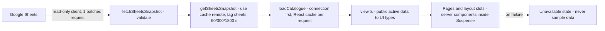

# Phase 5 Report — Product catalogue integration

Date: 2026-11-18 · Status: **implemented and tested against realistic fixtures; live Google Sheets verification is BLOCKED** (credentials, `.env.local`, `.env.example`, a browser and a running server were all unavailable to the agent). Awaiting owner review. Phase 6 not started.

## 1. Step 1 — Preflight (live Google Sheets): BLOCKED

| Check                                                                | Result                                                                                                                                                                               |
| -------------------------------------------------------------------- | ------------------------------------------------------------------------------------------------------------------------------------------------------------------------------------ |
| Environment variables configured                                     | **Cannot confirm.** `GOOGLE_*` are **not set** in the agent's environment; `.env.local` is masked from the sandbox                                                                   |
| `.env.example` contains the approved definitions                     | **Cannot confirm or modify** — the file is a protected device node in the sandbox (block to append is in `docs/ENVIRONMENT.md`)                                                      |
| Run the app / `/dev/sheets` with real credentials                    | **Not possible** — the sandbox refuses to start a server and to contact Google                                                                                                       |
| Read all four worksheets, check headers/parsing, data-quality report | **Not performed**                                                                                                                                                                    |
| Failure classification                                               | Not applicable (no attempt could be made). Nothing here was verified live; the integration is proven only against a scripted `fetch`, an in-memory fake sheet and realistic fixtures |

I proceeded with Steps 2–9 (code and tests) because they do not depend on live access, but **no statement in this report is a claim of live connectivity.**

### Owner preflight (≈10 minutes, please run and report)

1. `.env.local` has `GOOGLE_SERVICE_ACCOUNT_EMAIL`, `GOOGLE_PRIVATE_KEY` (one line, `\n` escapes), `GOOGLE_SHEET_ID`; append the block from `docs/ENVIRONMENT.md` to `.env.example`.
2. Spreadsheet shared with the service account; tabs `Products`, `Categories`, `Brands`, `BusinessSettings` (see `docs/GOOGLE_SHEETS_SETUP.md`, templates in `docs/sheets-template/`).
3. `npm run dev` → `/dev/sheets`: expect "Connected", 4 worksheets with row counts, and a (hopefully short) issue list. Failure hints: _denied access_ → sharing/API not enabled; _invalid_grant_ → email/key; _worksheet does not exist_ → tab names; _missing column_ → headers.
4. Then browse `/`, `/products`, a product page, `/bulk-enquiry`, `/contact`; check the keyboard/responsive items from `PHASE_3_REPORT.md`.
5. `npm run build && npm start`; `curl -i localhost:3000/products/no-such-slug` (see G36 about 404 vs 200).

## 2. Data flow and caching

- One shared cache entry serves every page, layout slot and metadata call; React `cache()` dedupes within a request (a failing sheet is not retried once per slot).
- **Request-time deferral** (`connection()` before the cached read): builds never read the sheet and a failure can never be prerendered into static HTML. Found by the production build, which executed the cached read during prerender and tripped on `new Date()` in the logger — see decision 46.
- Search, filters, sorting and pagination run in memory on the one snapshot (no per-filter Sheets requests). Cache durations are **unchanged** (stale 60 s / revalidate 300 s / expire 1800 s).
- Errors are never cached: a failure returns `{ ok: false }` and the next request tries again.

## 3. Routes connected

`/` (hero tagline, categories + images, featured, indicative-rates table, brands + logos, contact info, CTA), `/products` (search, category/brand/availability filters, sort, pagination, URL state, drawer), `/products/[slug]`, `/bulk-enquiry` (picker built server-side), `/contact`, plus the layout (header, footer incl. social links, announcement banner).

## 4. Behaviour summary

| Situation                                     | Result                                                                                                                       |
| --------------------------------------------- | ---------------------------------------------------------------------------------------------------------------------------- |
| Active product, valid price                   | Price + unit + "Updated: date" + exact disclaimer                                                                            |
| Missing/invalid price                         | "Rate on request" (never 0)                                                                                                  |
| Inactive product / inactive category or brand | Not in any listing, picker or direct URL (not-found)                                                                         |
| Unknown/malformed slug                        | not-found                                                                                                                    |
| All 4 stock statuses                          | Correct labels/colours; `AVAILABLE_ON_ORDER` selectable in bulk enquiry with availability shown                              |
| Units                                         | Canonical labels; custom label for CUSTOM; TON ≠ METRIC_TON                                                                  |
| Header-only worksheet                         | "No products are listed yet" (neutral, not an error)                                                                         |
| Sheet unreadable                              | `role="alert"` "Product information is temporarily unavailable" + link to contact; hero and enquiry CTA stay; no sample data |
| Optional data missing                         | Section hidden (contact info, brands, categories, featured); WhatsApp/call buttons absent                                    |
| Category image / brand logo                   | Shown only when configured                                                                                                   |

## 5. Security verification (tests + build output)

- All Sheets reads go through `features/catalogue/server.ts` (server-only); tests assert customer code imports nothing else from the catalogue/Sheets layer, nothing imports write functions, and only `server.ts` reads the cached snapshot.
- The read path uses `createSheetsReader` (no write methods) with the read-only scope. In the production output, `valueInputOption`, `values:batchUpdate`, `appendRow`, `updateCells` and every write log string are **absent from both server and client bundles**; `values:batchGet`/readonly scope appear only in the server bundle; no Sheets endpoint, credential name or `RSA-SHA256` in `.next/static`.
- Errors shown to users are generic; details are logged redacted. Inputs: slugs validated against the slug format; search params parsed and bounded; product ids for the enquiry list validated against the server-built catalogue (names/prices/units are never taken from the browser).

## 6. Tests

`tsc`, ESLint, Prettier and the production build pass; 554 tests in 24 files (see chat report). New: view layer (public filtering, mapping, slug lookup, related, enquiry items), loaders (success, empty, failure, deferral ordering), page-level integration for home/listing/detail/bulk/contact/layout slots over a realistic multi-page catalogue run through the real validation pipeline, security boundaries, read-only client.

## 7. Remaining placeholders and limitations

- **Live data unverified** (G35); browser/HTTP checks outstanding (G27).
- "Why choose us" is **not shown** — there is no sheet field for owner-approved statements (decision pending).
- `.env.example` unchanged (protected).
- Unknown/inactive product slug may return HTTP 200 with the not-found UI (streamed) instead of 404 (G36).
- A failing sheet is retried per request with no stale fallback beyond the cache window (G37).
- `noindex` removed from customer pages as planned; no sitemap/structured data yet (Phase 11).
- Category icons are chosen by keyword (presentation only); image/logo only when configured.
