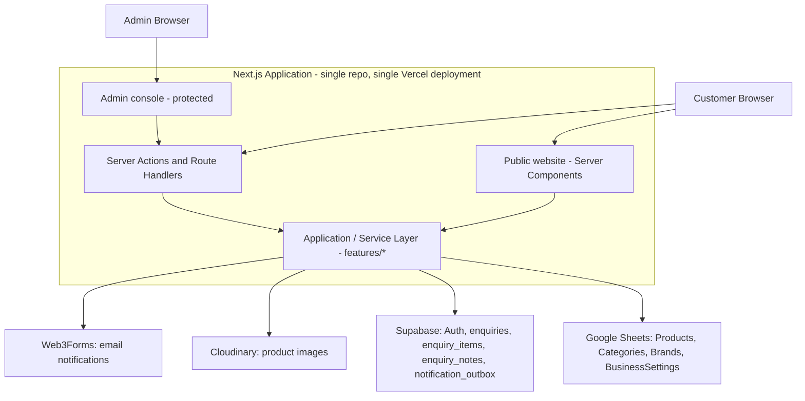
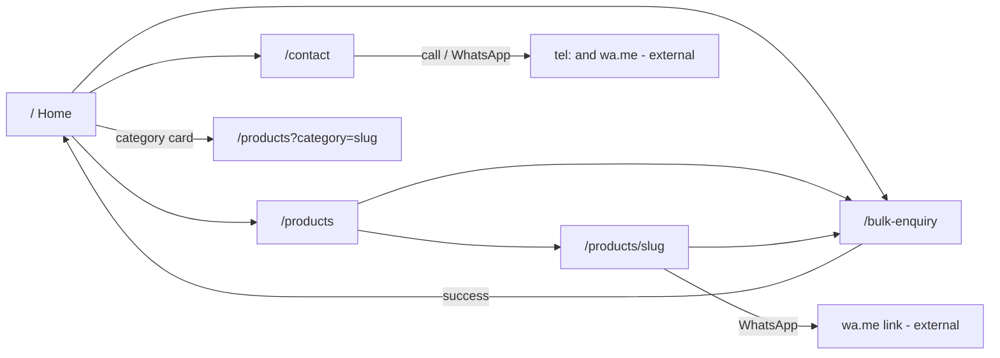
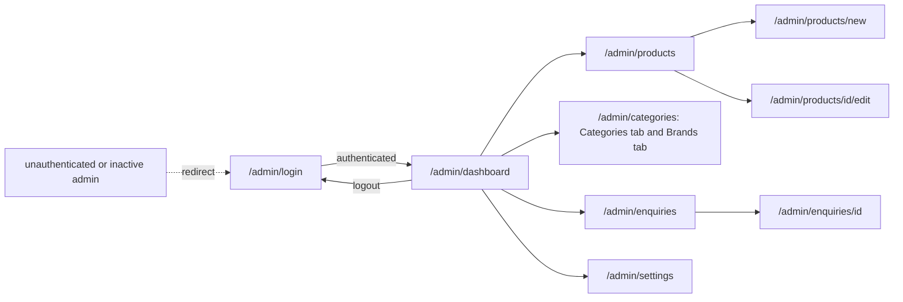
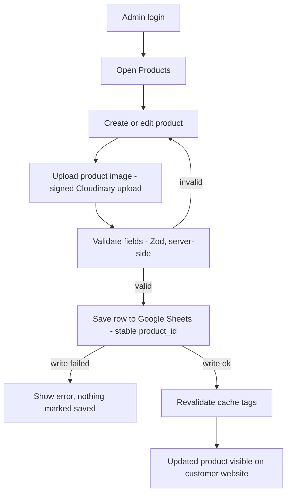
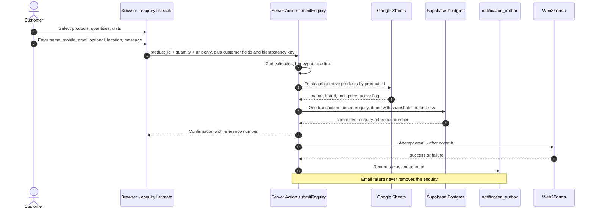
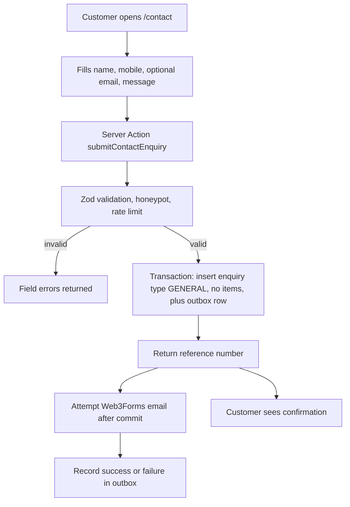
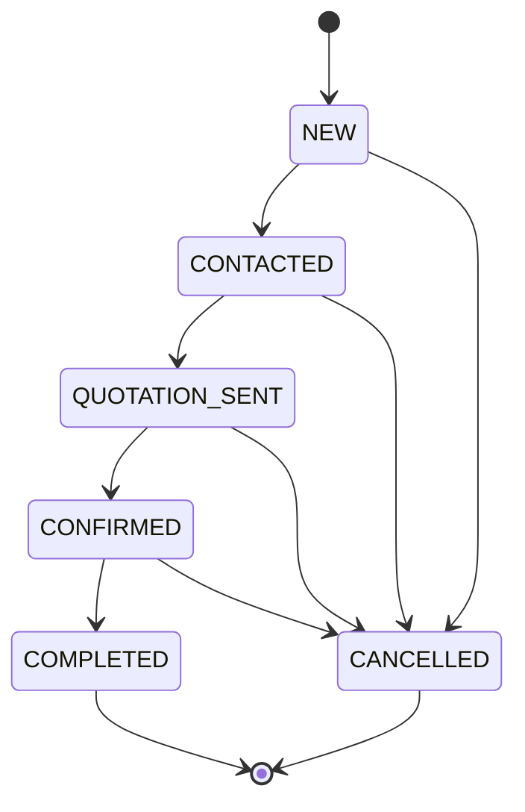
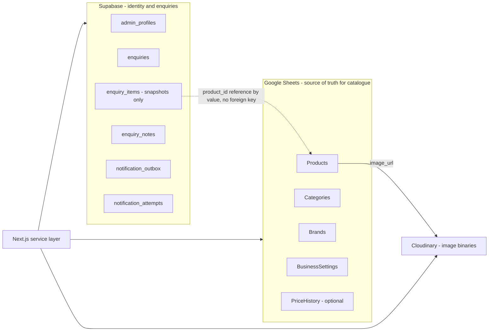
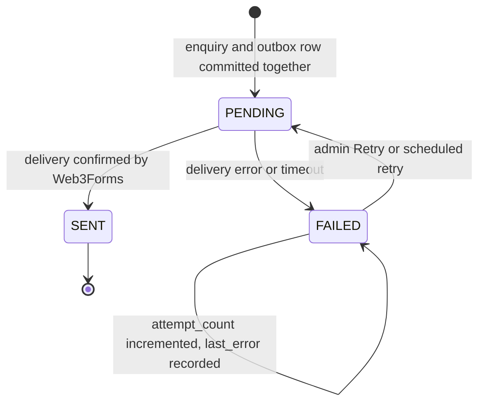
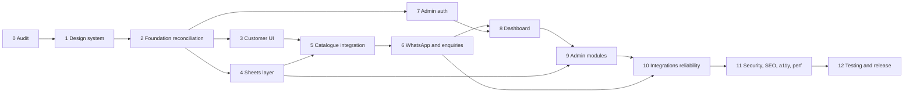

# Sagar Traders — Project Blueprint

**Document status:** v0.1 · generated 2026-11-18 · documentation only
**Source of truth for "what exists":** the repository at the time of writing (see §1.4). Everything else is a plan.

> This document is the central functional and technical reference for all remaining phases. It must be updated at the end of every phase. Where something could not be confirmed, it is marked **Needs verification** with the missing evidence.

## Status labels (used throughout)

| Label                   | Meaning                                                                         |
| ----------------------- | ------------------------------------------------------------------------------- |
| `IMPLEMENTED`           | Exists in the repository and was verified (build/lint/tests or file inspection) |
| `PARTIALLY IMPLEMENTED` | Some of it exists; the gap is stated                                            |
| `PLANNED`               | Approved/designed, not yet in the repository                                    |
| `PENDING DECISION`      | Needs an owner decision before it can be built                                  |
| `BLOCKED`               | Cannot proceed until an external input arrives                                  |
| `DEPRECATED`            | Superseded; kept for history                                                    |

## Table of contents

1. [Project overview](#1-project-overview)
2. [Technology stack](#2-technology-stack)
3. [High-level system architecture](#3-high-level-system-architecture)
4. [Customer website](#4-complete-customer-website)
5. [Product catalogue flow](#5-complete-product-catalogue-flow)
6. [Admin panel](#6-complete-admin-panel)
7. [Product management workflow](#7-product-management-workflow)
8. [Categories and brands workflow](#8-categories-and-brands-workflow)
9. [Bulk enquiry workflow](#9-bulk-enquiry-workflow)
10. [Contact enquiry workflow](#10-contact-enquiry-workflow)
11. [WhatsApp integration](#11-whatsapp-integration)
12. [Enquiry management workflow](#12-enquiry-management-workflow)
13. [Business settings](#13-business-settings)
14. [Data architecture](#14-data-architecture)
15. [Notification outbox architecture](#15-notification-outbox-architecture)
16. [API and Server Action architecture](#16-api-and-server-action-architecture)
17. [Authentication and authorization](#17-authentication-and-authorization)
18. [Image upload architecture](#18-image-upload-architecture)
19. [Security requirements](#19-security-requirements)
20. [UI/UX design system](#20-uiux-design-system)
21. [Reusable UI components](#21-reusable-ui-components)
22. [Responsive and accessibility standards](#22-responsive-and-accessibility-standards)
23. [SEO and performance](#23-seo-and-performance)
24. [Testing strategy](#24-testing-strategy)
25. [Deployment and environment configuration](#25-deployment-and-environment-configuration)
26. [Implementation roadmap](#26-implementation-roadmap)
27. [Decisions and constraints](#27-decisions-and-constraints)
28. [Known gaps and risks](#28-known-gaps-and-risks)
29. [Contradictions found while writing this document — resolution](#29-contradictions-found-while-writing-this-document--resolution)

---

## 1. Project overview

### 1.1 Summary

| Item          | Detail                                                                                                                                                                                                                                       |
| ------------- | -------------------------------------------------------------------------------------------------------------------------------------------------------------------------------------------------------------------------------------------- |
| Project       | **Sagar Traders**                                                                                                                                                                                                                            |
| Business      | Wholesale and retail supplier of building and construction materials (cement, steel/TMT, bricks and blocks, sand and aggregates, hardware and plumbing — per the Stitch designs; the exact catalogue is defined by the owner's Google Sheet) |
| Product       | A **product catalogue and enquiry-management platform**. It is **not** an ecommerce checkout: no cart payment, no online ordering, no payment gateway, no stock reservation                                                                  |
| Target users  | **Customers:** contractors, builders, construction enterprises, retail homeowners. **Administrator:** one business user (single admin)                                                                                                       |
| Hosting model | One Next.js repository, one Vercel deployment, no separate backend                                                                                                                                                                           |

### 1.2 Business objectives

1. Let customers discover products with **indicative** rates, units and availability.
2. Convert interest into **quotation enquiries** (single-product via WhatsApp, multi-product bulk enquiry, general contact).
3. Give the administrator one place to keep the catalogue and rates current and to work enquiries to completion.
4. Never present stale or unconfirmed information as a confirmed live rate.

### 1.3 Scope of v1

| Area          | Included in v1                                                                                                                                                | Excluded from v1                                                                                                                                                                     |
| ------------- | ------------------------------------------------------------------------------------------------------------------------------------------------------------- | ------------------------------------------------------------------------------------------------------------------------------------------------------------------------------------ |
| Customer site | Home, product listing, product detail, bulk enquiry, contact; search/filter/sort; WhatsApp and call actions                                                   | Accounts/login for customers, online payment, checkout, order tracking, reviews, wishlist, multi-language, delivery-cost calculation                                                 |
| Admin         | Login, dashboard, product CRUD (archive, no hard delete), categories & brands, enquiries (status, notes, retry notification), business settings, image upload | Multiple admin users/roles, bulk price editor, CSV export, stock quantity management, call logs, customer IP/geo tracking _(shown in Stitch; not approved — see `PROJECT_AUDIT.md`)_ |
| Data          | Google Sheets (catalogue, settings), Supabase (admin identity, enquiries), Cloudinary (images), Web3Forms (email)                                             | Duplicating catalogue data in Supabase, inventory quantities, firm and buyer-type fields                                                                                             |
| Operations    | Outbox-based notifications with retry                                                                                                                         | Guaranteed background worker unless Phase 10 implements one (see §15)                                                                                                                |

_Items marked "shown in Stitch; not approved" (Export CSV, Bulk Price Editor, Stock Watchlist, depot stock quantities, IP/call duration) are treated as **PENDING DECISION → default excluded** until the owner approves them._

### 1.4 Implementation snapshot (verified 2026-11-18)

| Area                              | Status                                                                                                                                                                                                      | Evidence                                                                                                              |
| --------------------------------- | ----------------------------------------------------------------------------------------------------------------------------------------------------------------------------------------------------------- | --------------------------------------------------------------------------------------------------------------------- |
| Next.js app, layouts, route stubs | `PARTIALLY IMPLEMENTED`                                                                                                                                                                                     | `src/app/**` — placeholder pages only                                                                                 |
| Design tokens (`tokens.css`)      | `IMPLEMENTED`                                                                                                                                                                                               | `src/styles/tokens.css`, build verified                                                                               |
| UI component library              | `IMPLEMENTED` (some components reconstructed)                                                                                                                                                               | `src/components/ui/*`, 26 tests                                                                                       |
| Env validation (Zod)              | `PARTIALLY IMPLEMENTED`                                                                                                                                                                                     | `src/lib/env/{server,public}.ts`; validated lazily, integration vars all optional                                     |
| Error/logging utilities           | `PARTIALLY IMPLEMENTED`                                                                                                                                                                                     | `src/lib/errors.ts`, `logger.ts` — gaps in §28                                                                        |
| Test tooling                      | `IMPLEMENTED` (unit/component only)                                                                                                                                                                         | vitest config, 4 test files                                                                                           |
| Customer pages                    | `PARTIALLY IMPLEMENTED` — **Phase 5: connected to the validated Google Sheets catalogue** (server-side, cached, request-time); **live data NOT verified** (no credentials/browser in the agent environment) | `src/app/(website)/**`, `src/components/website/**`, `src/features/catalogue/server.ts`; see `docs/PHASE_5_REPORT.md` |
| Google Sheets integration         | `PARTIALLY IMPLEMENTED` — server-side client, validation, caching and writes built and tested with mocks (Phase 4); **live connectivity not tested**; not wired into customer pages (Phase 5)               | `src/lib/google-sheets/**`, `src/features/catalogue/**`; see `docs/PHASE_4_REPORT.md`                                 |
| Supabase (Auth, DB, RLS)          | `PLANNED` (Phases 6–7)                                                                                                                                                                                      | no SDK dependency, no `supabase/` directory, no migrations                                                            |
| Cloudinary                        | `PLANNED` (Phase 10)                                                                                                                                                                                        | no dependency or code                                                                                                 |
| Web3Forms                         | `PLANNED` (Phases 6/10)                                                                                                                                                                                     | no code                                                                                                               |
| Admin authentication              | `PLANNED` (Phase 7)                                                                                                                                                                                         | `/admin/*` is **currently unprotected placeholder pages**                                                             |
| Git / GitHub                      | Not started (deferred by owner)                                                                                                                                                                             | not a git repository                                                                                                  |
| Visual verification vs Stitch     | `BLOCKED`                                                                                                                                                                                                   | no screenshots supplied                                                                                               |

Existing documentation reviewed for this blueprint: `PROJECT_AUDIT`, `STITCH_DESIGN_INVENTORY`, `DESIGN_SYSTEM_AUDIT`, `ARCHITECTURE`, `IMPLEMENTATION_PLAN`, `RISK_REGISTER`, `DECISIONS`, `DESIGN_SYSTEM`, `COMPONENT_USAGE`, `FOUNDATION`, `FOUNDATION_RECONCILIATION`, plus all 13 Stitch `code.html` files and `sagar_traders_design_system.md`.

---

## 2. Technology stack

Versions are the **installed** versions (from `node_modules`, matching `package-lock.json`; Node 24.19.0 on the dev machine). "Planned" means _not installed_.

### 2.1 Installed

| Technology                                      | Installed version                           | Purpose                                 | Where used                                     | Notes                                                                                                                                                                                                                                                                           |
| ----------------------------------------------- | ------------------------------------------- | --------------------------------------- | ---------------------------------------------- | ------------------------------------------------------------------------------------------------------------------------------------------------------------------------------------------------------------------------------------------------------------------------------- |
| Next.js (App Router)                            | 16.4.6                                      | Full-stack framework                    | `src/app/**`, `next.config.ts`                 | **Differs from older Next.js**: `proxy.ts` replaces `middleware`; `cacheComponents` and `partialPrefetching` enabled in config; typed `LayoutProps<"/">`; `error.tsx` receives `retry` (preferred) and `reset`. Always consult `node_modules/next/dist/docs/` (per `AGENTS.md`) |
| React / React DOM                               | 19.3.0                                      | UI                                      | everywhere                                     | Server Components by default; `"use client"` only for interactive components                                                                                                                                                                                                    |
| TypeScript                                      | 5.9.3                                       | Language                                | all `src`                                      | `strict: true`; path alias `@/*` → `src/*`                                                                                                                                                                                                                                      |
| Tailwind CSS                                    | 4.3.3 (+ `@tailwindcss/turbopack` 4.3.3)    | Styling                                 | `src/app/globals.css`, `src/styles/tokens.css` | CSS-first config (`@theme`); there is **no `tailwind.config.ts`**. Scan scoped to `src/` via `source(none)` + `@source`                                                                                                                                                         |
| Custom UI library (cva + clsx + tailwind-merge) | cva 0.7.1, clsx 2.1.1, tailwind-merge 3.7.0 | Component system                        | `src/components/ui/`                           | See rationale below                                                                                                                                                                                                                                                             |
| Lucide React                                    | 1.75.0                                      | Icons                                   | UI components                                  | Only icon set (Stitch's Material Symbols are not used)                                                                                                                                                                                                                          |
| Zod                                             | 4.6.7                                       | Validation                              | `src/lib/env/*` today; all server input later  | Single validation approach for env, forms, actions                                                                                                                                                                                                                              |
| server-only                                     | 0.0.1                                       | Prevent client import of server modules | `src/lib/env/server.ts`                        | Must be imported by every credentialed module                                                                                                                                                                                                                                   |
| Inter via `next/font/google`                    | —                                           | Typography                              | `src/app/layout.tsx`                           | `latin` subset preloaded; `latin-ext` (covers ₹) is self-hosted but not preloaded                                                                                                                                                                                               |
| Vitest                                          | 5.1.1                                       | Test runner                             | `vitest.config.mts`                            | jsdom environment, globals enabled                                                                                                                                                                                                                                              |
| Testing Library (react, jest-dom)               | 16.3.3 / 7.0.1                              | Component tests                         | `*.test.tsx`                                   | `user-event` intentionally not installed; `fireEvent` used                                                                                                                                                                                                                      |
| jsdom                                           | 31.0.1                                      | DOM for tests                           | vitest                                         | `HTMLDialogElement` polyfilled in `vitest.setup.ts`                                                                                                                                                                                                                             |
| ESLint (+ `eslint-config-next`)                 | 9.39.5 / 16.4.6                             | Linting + design-token enforcement      | `eslint.config.mjs`                            | Custom `no-restricted-syntax` rules ban off-palette colours, `dark:`, inline `style`                                                                                                                                                                                            |
| Prettier                                        | 3.10.1                                      | Formatting                              | `.prettierrc.json`                             | Not part of `lint` script                                                                                                                                                                                                                                                       |
| npm                                             | 11.17.0                                     | Package manager                         | —                                              | `package-lock.json` committed to repo tree                                                                                                                                                                                                                                      |

### 2.2 Planned (not installed)

| Technology                                                   | Purpose                     | Phase | Notes                                                                                                                                                    |
| ------------------------------------------------------------ | --------------------------- | ----- | -------------------------------------------------------------------------------------------------------------------------------------------------------- |
| `@supabase/supabase-js`, `@supabase/ssr`                     | Postgres client, Auth SSR   | 6–7   | Use the SSR pattern documented for Next 16; **Needs verification** of current API at install time                                                        |
| ~~`googleapis`~~ → REST via `fetch` (**decided in Phase 4**) | Google Sheets               | 4     | No dependency added: service-account JWT signed with Node `crypto`, Sheets REST v4 via `fetch`. Smaller, auditable, fully testable with a mocked `fetch` |
| Cloudinary SDK or signed REST upload                         | Images                      | 10    | Server signs; browser uploads                                                                                                                            |
| Web3Forms (HTTP API, no SDK needed)                          | Email                       | 6/10  | Access key server-side                                                                                                                                   |
| Rate-limit store                                             | Rate limiting on serverless | 6     | **PENDING DECISION** (e.g. Upstash Redis or a Supabase table); in-memory counters do not work across serverless instances                                |
| Playwright                                                   | E2E                         | 12    | Not installed                                                                                                                                            |
| `vitest-axe` / `jest-axe`                                    | Accessibility tests         | 11    | Deferred by owner until Phase 11                                                                                                                         |
| Vercel, GitHub                                               | Hosting, source control     | 12    | No repository or project exists yet                                                                                                                      |

### 2.3 Why the custom component library (and not shadcn/ui)

`DECISIONS`: _the custom library replaces shadcn/ui; shadcn/ui must not be introduced alongside it._ Reasons: (1) the spec defines its own tokens and the default Tailwind palette/radii are deliberately cleared, which conflicts with shadcn/Radix default theming; (2) the library is small, uses native `<dialog>` and the WAI-ARIA tabs pattern, and is covered by tests; (3) a single implementation per component avoids a second design system. Trade-off: searchable select, drawer exit animation and some components must be built by us.

---

## 3. High-level system architecture

### 3.1 Diagram (planned architecture)

### 3.2 Principles

- **One repository, one Vercel deployment.** No separately deployed backend (no Express).
- **Public website** (Server Components, cached catalogue reads) and **protected admin** share components and services.
- **Server-only credentials.** Google service-account key, Supabase service-role key, Cloudinary API secret and Web3Forms access key are read only in server modules (`import "server-only"`), never in client bundles.
- **Service layer** (`src/features/*`): business rules and validation live here once; Server Actions, Route Handlers and Server Components call it. UI never talks to Sheets/Supabase directly.

### 3.3 Responsibility of each external service

| Service                    | Owns                                                                                              | Does **not** own                                       |
| -------------------------- | ------------------------------------------------------------------------------------------------- | ------------------------------------------------------ |
| Google Sheets              | Products, categories, brands, business settings (+ optional price history)                        | Enquiries, admin identity, images                      |
| Supabase (Postgres + Auth) | Admin identity/profile, enquiries, enquiry items (snapshots), notes, notification outbox/attempts | Product master data (no duplication)                   |
| Cloudinary                 | Image binaries and delivery                                                                       | Product records (only the URL is stored, in the Sheet) |
| Web3Forms                  | Email delivery to the business                                                                    | Enquiry persistence (Supabase is the record)           |
| Vercel                     | Hosting, edge/CDN, env vars, (optionally) cron                                                    | State                                                  |

### 3.4 Implementation status of the architecture

Only the Next.js shell, design system and utilities exist (`IMPLEMENTED`/`PARTIALLY IMPLEMENTED`). **No external service is integrated.** `src/features/`, `src/hooks/`, `src/types/`, `src/app/api/` and the `lib/{google-sheets,supabase,cloudinary,email,whatsapp,validation}` modules do not exist yet (`PLANNED`).

---

## 4. Complete customer website

Global behaviour (applies to all public pages) — `PLANNED` unless stated:

- **Layout:** `src/app/(website)/layout.tsx` = `SiteHeader` + `<main>` + `SiteFooter` (`IMPLEMENTED`, minimal). White canvas, black text, `PageContainer` max width 1280px.
- **Header (target):** wordmark (text placeholder; no logo exists), nav (Home, Products, Bulk Enquiry, Contact), click-to-call and WhatsApp actions from BusinessSettings, mobile menu (the Stitch menu button was non-functional — must be built), optional announcement banner slot (from settings). _Currently:_ wordmark + 4 links only, no mobile menu.
- **Footer (target):** business description, quick links, materials/categories, helpline/WhatsApp, GST number — **all from BusinessSettings, never hard-coded**. Indicative-rates notice. _Currently:_ copyright line.
- **Not carried over from Stitch:** the "DEMO PROTOTYPE" banner, "Admin Login" link in the public top bar _(Needs decision: public link to admin is not recommended)_, all demo phone numbers/addresses/GSTIN.
- **Internal links** use Next.js routes (`next/link`), not Stitch's `*.html` paths.

### 4.1 `/` — Homepage (`PARTIALLY IMPLEMENTED`: data-connected in Phase 5; live data unverified; sections without data are hidden)

| Aspect       | Specification                                                                                  |
| ------------ | ---------------------------------------------------------------------------------------------- |
| Purpose      | Introduce the business; route visitors to products, bulk enquiry and contact                   |
| Target user  | New and returning customers, mostly on mobile                                                  |
| Data sources | Categories, featured products, brands, settings (Google Sheets, via service layer)             |
| Interactions | CTA buttons, category cards (→ filtered listing), product "View Details", WhatsApp quote links |
| Validation   | None (no forms on this page)                                                                   |
| Responsive   | Single column on mobile → multi-column grids ≥ `md`/`lg`; hero stacks                          |
| Navigation   | `/products`, `/products?category=…`, `/products/[slug]`, `/bulk-enquiry`, `/contact`, WhatsApp |

Sections in order:

1. **Header** (above).
2. **Hero** — headline, supporting text, primary CTA "Explore Products", secondary "Get a Bulk Quote". _Stitch copy "Serving … Since 2008", "450+ MT dispatch", "Same-day delivery", "100% Original Certified Brands", "35,000 sq.ft" are **unverified claims — excluded** until the owner confirms (`PROJECT_AUDIT`)._ Stat tiles appear only with verified values.
3. **Product categories** — cards from the Categories sheet ordered by `display_order`, active only; empty state if none.
4. **Featured products** — active products with `is_featured`; product card (image, name, brand, indicative rate/unit, stock badge, last updated, View Details, WhatsApp).
5. **Product rates / catalogue** — rate table of selected products with the **price disclaimer** and per-row "last updated". Must **not** be titled "Live" (Stitch's "Live Depot Price Board" implies freshness we cannot guarantee). Hidden prices when data is stale/unavailable (§5.4).
6. **Why Choose Us** — **PENDING CONTENT**: the Stitch points (verified shipments, competitive pricing, trusted brands, wholesale & retail) are unverified claims; include only owner-approved statements.
7. **Brands** — active brands from the Brands sheet (logo/name). Stitch lists UltraTech, Tata Tiscon, Jindal, ACC, Ambuja, Finolex as _samples_; **no dealership relationship may be implied** without confirmation.
8. **Bulk enquiry CTA** — white surface with bordered card and navy/amber **component accents** (the Stitch full-navy section is not approved).
9. **Contact information** — address, phones, email, hours, map from BusinessSettings; map embed from Google Maps URL setting.
10. **Footer.**

### 4.2 `/products` — Product listing (`PARTIALLY IMPLEMENTED`: data-connected in Phase 5 — active products only, in-memory filter/sort/pagination over one cached snapshot; live data unverified)

Purpose: browse/search the catalogue. Users: all customers. Layout: breadcrumb, heading, "Build multi-material quote" action, filter sidebar (desktop) / filter drawer (mobile), results grid, pagination. Data: Products+Categories+Brands (Sheets). Interactions: search, category/brand/stock filters, sort, pagination, product card actions, add to enquiry list. Validation: query parameters are parsed and bounded with Zod (page ≥ 1, allowed sort keys, known slugs). Responsive: filters collapse into `Drawer` below `lg`. Navigation: `/products/[slug]`, `/bulk-enquiry`. Details in §5.

### 4.3 `/products/[slug]` — Product detail (`PARTIALLY IMPLEMENTED`: data-connected in Phase 5; inactive/unknown slugs → not-found; live data unverified)

Purpose: full product information and enquiry. Layout: breadcrumb (Home › Category › Product), image, name, brand, SKU (if present), stock badge, indicative rate + unit + last updated, description, specifications table, enquiry panel (quantity + delivery location → WhatsApp enquiry; "Add to bulk quotation list"), price disclaimer, related products. Data: Sheets by `slug`; unknown/inactive slug → `notFound()`. Validation: quantity (positive number), location (bounded text) before building the WhatsApp message. Metadata/JSON-LD per §23. Stitch extras "IS 1489 verified", "Tamper proof", "Minimum wholesale order: 50 Bags" are unverified and excluded unless they exist in the product's own sheet data.

### 4.4 `/bulk-enquiry` — Bulk quotation request (`PARTIALLY IMPLEMENTED`: product picker from the real catalogue; **Phase 6: submission saves a BULK enquiry with server-built item snapshots** — mock/real-PostgreSQL tested; live Supabase and email delivery unverified)

Purpose: multi-product quotation enquiry (not a checkout). Layout: enquiry list builder (product search + quantity + unit rows), customer details form, indicative total (**server-computed**, labelled indicative, excludes freight/GST), submit, confirmation state with reference number. Workflow and rules in §9.

### 4.5 `/contact` — Contact (`PARTIALLY IMPLEMENTED`: details from business settings; **Phase 6: submission saves a GENERAL enquiry**; live Supabase and email delivery unverified)

Purpose: show how to reach the business and accept a general enquiry. Layout: contact cards (phones, WhatsApp, address, email, hours — from settings), map area, general enquiry form (name, mobile, optional email, message). Persistence via Server Action (§10). The Stitch "Buyer Type" field is **excluded** (decision 3).

### 4.6 Other public routes

| Route                                    | Status                              | Notes                                                                   |
| ---------------------------------------- | ----------------------------------- | ----------------------------------------------------------------------- |
| `not-found` / `error` / `loading` (root) | `IMPLEMENTED` (basic)               | `global-error.tsx` missing (§28)                                        |
| `/robots.txt`                            | `IMPLEMENTED`                       | disallows `/admin`, `/api`, `/dev`                                      |
| `/sitemap.xml`                           | `PLANNED` (Phase 11)                |                                                                         |
| `/dev/components`                        | `IMPLEMENTED`, **development only** | 404 in production, but its client chunk still ships — fix pending (§28) |

---

## 5. Complete product catalogue flow

### 5.1 Features

| Capability        | Specification                                                                                                                                                                          | Status                                     |
| ----------------- | -------------------------------------------------------------------------------------------------------------------------------------------------------------------------------------- | ------------------------------------------ |
| Listing           | Active products only; server-rendered; cached                                                                                                                                          | `PLANNED` (Phase 5)                        |
| Category filter   | By category slug (active categories); category counts optional                                                                                                                         | `PLANNED`                                  |
| Brand filter      | By brand slug (active brands)                                                                                                                                                          | `PLANNED`                                  |
| Stock filter      | Any of the stock statuses                                                                                                                                                              | `PLANNED`                                  |
| Search            | Case-insensitive over name, brand, category, **SKU** and description; trimmed, length-bounded                                                                                          | `PLANNED`                                  |
| Sort              | Featured first (default), price low→high, price high→low, recently updated. Products **without a price sort last** and are never treated as 0                                          | `PLANNED`                                  |
| Pagination        | Page-number pagination via `Pagination` component (URL `?page=`), page size to be fixed in Phase 5 (Stitch shows 8/page)                                                               | `PLANNED`                                  |
| Product detail    | `/products/[slug]`                                                                                                                                                                     | `PLANNED`                                  |
| Related products  | Same category, excluding self, active only, limited                                                                                                                                    | `PLANNED`                                  |
| Featured products | `is_featured = true` and active                                                                                                                                                        | `PLANNED`                                  |
| Active/inactive   | Inactive/archived products are hidden from the public site and cannot be enquired                                                                                                      | `PLANNED`                                  |
| SKU               | **Optional**; unique when present; searchable in admin and public search; not mandatory for existing rows                                                                              | `PLANNED`                                  |
| Images            | Cloudinary URL from `image_url`; `next/image` with allowed host `res.cloudinary.com` (already in `next.config.ts`); descriptive alt from product name; neutral placeholder when absent | `PARTIALLY IMPLEMENTED` (host config only) |

### 5.2 Stock statuses

**Approved: all four statuses are retained.** `AVAILABLE_ON_ORDER` is kept even though it does not appear in the Stitch designs. Badge colours use palette tokens only.

| Value                | Customer-facing label | Badge colour (token)                      | Status                                                                                                                         |
| -------------------- | --------------------- | ----------------------------------------- | ------------------------------------------------------------------------------------------------------------------------------ |
| `IN_STOCK`           | In Stock              | Success green `#166534` (`success`)       | `IMPLEMENTED` (badge)                                                                                                          |
| `LIMITED_STOCK`      | Limited Stock         | Warning amber-brown `#B45309` (`warning`) | `IMPLEMENTED` (badge)                                                                                                          |
| `OUT_OF_STOCK`       | Out of Stock          | Error red `#B91C1C` (`error`)             | `IMPLEMENTED` (badge)                                                                                                          |
| `AVAILABLE_ON_ORDER` | Available on Order    | Info blue `#1D4ED8` (`info`)              | `PLANNED` — **not yet in code**: the existing `StockStatus` type in `src/components/ui/status-badge.tsx` has only three values |

Required work (not started; documentation task only so far): add `AVAILABLE_ON_ORDER` to the shared `StockBadge`/`StockStatus` in the common badge component, to Sheets `stock_status` validation (Phase 4), to the stock filter (Phase 5) and to product-management validation and the status selector (Phase 9A). The badge appearance (solid vs outline) for this status follows the other stock badges (solid) unless the owner specifies otherwise. Whether `AVAILABLE_ON_ORDER` products can be added to a bulk enquiry is expected to be **yes** (they are active products); this is stated here as the default and can be revised.

**Decision (bulk enquiry):** `AVAILABLE_ON_ORDER` products **may be added to a bulk enquiry**; their availability status must be shown clearly in the enquiry list and stored in the enquiry item snapshot so the administrator sees it.

### 5.3 Units

**Approved: support the complete unit list plus custom units, using a canonical unit value in the data model and a separate display label.** Units are never silently converted, and `TON` and `METRIC_TON` are **not** assumed to be interchangeable in the business data.

| Canonical value | Display label | Notes                                                |
| --------------- | ------------- | ---------------------------------------------------- |
| `BAG`           | Bag           |                                                      |
| `PIECE`         | Piece         |                                                      |
| `KG`            | Kg            |                                                      |
| `TON`           | Ton           | Distinct from `METRIC_TON`                           |
| `METRIC_TON`    | Metric Ton    | Distinct from `TON`; Stitch showed "Metric Ton (MT)" |
| `CUBIC_FEET`    | Cubic Feet    | Stitch showed "Cubic Foot (CFT)"                     |
| `CUBIC_METER`   | Cubic Meter   |                                                      |
| `BUNDLE`        | Bundle        |                                                      |
| `BOX`           | Box           |                                                      |
| `METER`         | Meter         |                                                      |
| `BLOCK`         | Block         | Stitch showed "Block"                                |
| `BRASS`         | Brass         |                                                      |
| `CUSTOM`        | Custom unit   | Free text stored alongside (see below)               |

**Owner confirmation (final):** the canonical unit list is exactly `BAG`, `PIECE`, `KG`, `TON`, `METRIC_TON`, `CUBIC_FEET`, `CUBIC_METER`, `BUNDLE`, `BOX`, `METER`, `BRASS`, `BLOCK` and `CUSTOM`. `TON` and `METRIC_TON` are separate canonical values with no automatic conversion. `CUSTOM` supports a user-defined **display label** (the text the administrator types). "50 kg Bag" is a **pack description** and "3m Length" is a **product size/specification**; neither is a unit — they belong in the product name or specifications, never in `unit`. This supersedes the earlier "to confirm" notes.

The table above is the confirmed specification and is implemented as constants in `src/features/products/units.ts` (Phase 3: labels and validation helpers only; sheet validation arrives in Phase 4).

Rules (`PLANNED`):

- **Data model:** the Products sheet stores the canonical value in `unit`. For `CUSTOM`, the user-defined display label is stored in a separate `unit_custom` column (**to be added to the sheet design in Phase 4**; not a Phase 3 change). `unit_custom` must be empty for every other unit.
- **Admin:** the product form lets the administrator **select a predefined unit or choose "Custom unit" and type one** (bounded length, trimmed, rendered escaped).
- **Validation:** the canonical value is validated server-side against the enum; `CUSTOM` requires non-empty custom text; an unknown value is a validation error, never defaulted.
- **Display:** public pages and the admin show the display label (or the custom text); filters/sorts use canonical values.
- **Enquiries:** the unit shown on an enquiry item is the **snapshot** (canonical value + display text) taken at submission.

### 5.4 Price display, disclaimer and honesty rules

Approved disclaimer (exact text, shown wherever a price appears):

> **"Prices are indicative and subject to change. Please confirm the final rate before placing an order."**

Rules (`PLANNED`, enforced in Phases 4–5):

1. Show price with unit and **"Last updated"** derived from the product's `updated_at`; never fabricate timestamps.
2. Cache life **5 minutes**; **maximum acceptable staleness 30 minutes** _(proposal in `ARCHITECTURE.md`; to be ratified in Phase 5)_.
3. If Google Sheets is unavailable and the last good data is older than the maximum staleness → **suppress prices** and show "Rate unavailable — request a quotation". Never show a stale value as current, never invent a value.
4. A malformed product row is excluded (and reported with worksheet, row and column), never shown with defaults. **Field-level problems** (invalid price, date, image URL, specifications JSON) drop only that field: an invalid or non-positive price becomes "no price" and the product shows "Rate on request" — never 0 — and a warning is reported. Blank price is valid (no price).
5. Do not label the table "Live". Use "Indicative rates".
6. Admin updates call cache revalidation so changes appear promptly; direct edits made in the spreadsheet itself appear at the next cache refresh (§14.5).

---

## 6. Complete admin panel

> Status: **all admin routes are placeholder stubs and currently unauthenticated** (`PARTIALLY IMPLEMENTED`). They must not be deployed before Phase 7. The Stitch admin designs are the layout reference; Stitch admin pages are not responsive (login, product list, enquiry list have no responsive classes) and have no mobile sidebar — mobile behaviour is **PENDING DESIGN APPROVAL**.

### 6.1 Route map

| Route                       | Purpose                                                                           | Repository status                                                                                                                                                   |
| --------------------------- | --------------------------------------------------------------------------------- | ------------------------------------------------------------------------------------------------------------------------------------------------------------------- |
| `/admin/login`              | Administrator sign-in                                                             | stub; **inherits the console sidebar layout today** (to be fixed in Phase 7 with route groups `admin/(auth)` and `admin/(console)`)                                 |
| `/admin/dashboard`          | Overview                                                                          | stub                                                                                                                                                                |
| `/admin/products`           | Product list                                                                      | stub                                                                                                                                                                |
| `/admin/products/new`       | Create product                                                                    | **missing**                                                                                                                                                         |
| `/admin/products/[id]/edit` | Edit product                                                                      | **missing** (Stitch: add/edit form). Brief names `[id]/edit`; earlier docs said `[id]` — use `[id]/edit`                                                            |
| `/admin/categories`         | Categories and Brands: one page, two tabs (Categories, Brands), one sidebar entry | **Approved route.** Repo has stubs `/admin/categories` and `/admin/brands`; merge into one page is an approved fix **before Phase 3**; `/admin/catalog` is not used |
| `/admin/enquiries`          | Enquiry list                                                                      | stub                                                                                                                                                                |
| `/admin/enquiries/[id]`     | Enquiry detail                                                                    | **missing**                                                                                                                                                         |
| `/admin/settings`           | Business settings                                                                 | stub                                                                                                                                                                |

### 6.2 Shared console layout (`PARTIALLY IMPLEMENTED`)

Sidebar 260px (`w-sidebar`) with one entry each for Dashboard, Products, **Categories & Brands (single entry)**, Enquiries (with count badge of NEW), Business Settings; user area with logout; "View website" link. Header with page title/breadcrumbs and profile menu. White page canvas (no gray canvas), bordered cards. Below `lg` the sidebar becomes a `Drawer` (`PLANNED`, Phase 8). `ToastProvider` mounted in the console layout (`PLANNED`). Currently: sidebar with links only; nav config still lists Categories and Brands separately (`src/config/navigation.ts`).

### 6.3 Screen specifications

**`/admin/login`** — Purpose: sign in the single administrator. Layout: centred card **without** console sidebar. Fields: email, password (show/hide), optional "keep session" (**Needs decision**; session lifetime is controlled by Supabase settings). Actions: Sign in; link back to website. **Must not** show demo credentials (Stitch did) or a public registration/reset link unless a recovery procedure is approved (Phase 7 documents recovery). Validation: Zod; generic error "Invalid email or password" (no account enumeration); rate limiting. States: submitting, error. Permissions: public route; redirects authenticated admins to dashboard.

**`/admin/dashboard`** — Purpose: status at a glance. Data (all derived from real sources, **never hard-coded**): total/active/inactive/out-of-stock products, categories, brands (Sheets); total and pending (`NEW`) enquiries, recent enquiries, enquiry status overview (Supabase); recently updated products and rates (Sheets `updated_at`/PriceHistory). Actions: add product, view all enquiries, open enquiry. States: skeletons, empty ("No enquiries yet"), partial-failure notification when one source fails (the other still renders). Stitch's "Stock Watchlist" (quantity-based) and "Bulk Price Editor" are **excluded** pending decision.

**`/admin/products`** — Purpose: manage the catalogue. Table: name (+ SKU), brand, category, rate, unit, stock status, catalogue status (active/inactive/archived), last updated, actions (view on site, edit, archive). Search (name, SKU, brand), filters (category, brand, stock, status), sort, pagination. Empty/loading/error states. "Export CSV" **excluded** pending decision. Permissions: admin only.

**`/admin/products/new` and `/admin/products/[id]/edit`** — see §7.

**Categories & Brands (`/admin/categories`, tabs: Categories / Brands)** — see §8.

**`/admin/enquiries`** and **`/admin/enquiries/[id]`** — see §12.

**`/admin/settings`** — see §13.

All admin screens: every read/write is authorised server-side (§17); destructive actions use `AlertModal`; success/failure surfaced via toast/notification; forms use `Field` for accessible errors.

---

## 7. Product management workflow

### 7.1 Fields

| Field            | Rule                                                                                                                                         |
| ---------------- | -------------------------------------------------------------------------------------------------------------------------------------------- |
| Product name     | Required, trimmed, bounded length                                                                                                            |
| Slug             | Auto-suggested from name, editable, **unique** across products, URL-safe; changing it after publish needs a warning (breaks links)           |
| SKU              | Optional; if provided, **unique** among products; included in admin search                                                                   |
| Category         | Required; must reference an **existing** category; inactive category selectable only with a warning                                          |
| Brand            | Required (or optional — **PENDING DECISION**; Stitch marks Brand required); must reference an existing brand                                 |
| Description      | Plain text, bounded; rendered escaped (no raw HTML)                                                                                          |
| Specifications   | Key/value rows (Stitch UI). Stored in the single `specifications` column as **JSON** (serialisation to be fixed in Phase 4)                  |
| Image            | Optional; Cloudinary URL stored in `image_url` (§18)                                                                                         |
| Indicative price | Optional number ≥ 0 with bounded precision; **blank ≠ 0**; invalid input is rejected, never converted to 0                                   |
| Unit             | From the unit enum (§5.3)                                                                                                                    |
| Stock status     | From the stock-status enum (§5.2)                                                                                                            |
| Featured         | boolean (`is_featured`); Stitch had a separate "Display on Homepage Rate Board" flag — **PENDING DECISION** whether it maps to the same flag |
| Active           | boolean (`is_active`)                                                                                                                        |

### 7.2 Lifecycle rules

- **Create:** server generates a stable `product_id` (not a row number), sets `created_at`/`updated_at`.
- **Edit:** updates by `product_id` (never by row index); sets `updated_at`; price change optionally appends to `PriceHistory` with `updated_by`.
- **Price/stock quick update:** same validation, same write path.
- **Archive instead of delete:** archive = `is_active = false` (plus an archived marker if the schema adds one — **PENDING DECISION**: sheet schema has only `is_active`; "Inactive" and "Archived" cannot be distinguished without another column). No destructive row deletion in v1.
- **Concurrency:** one administrator reduces risk but does not remove it (spreadsheet may also be edited by hand). Writes re-read and verify the target row's `product_id` before updating; header validation precedes every write.
- **Failure handling:** a write is reported successful only after the Sheets API confirms it; on failure show an error and keep form state; never partially update cache. After success, `revalidateTag` for catalogue tags. Image upload and sheet write are separate steps: an uploaded-but-unsaved image is an orphan handled by the cleanup policy (§18).
- All of the above is `PLANNED` (Phases 4 and 9).

---

## 8. Categories and brands workflow

Approved structure: **one combined management page, one sidebar entry, separate Categories and Brands tabs** (use the `Tabs` component; selected tab reflected in the URL, e.g. `?tab=brands`). **Route: `/admin/categories`, with two tabs: Categories and Brands** (confirmed by the owner; `/admin/catalog` is **not** introduced). Status: `PLANNED` (merge scheduled **before Phase 3** as an approved foundation fix; management features in Phase 9). The repo currently still has two separate stubs, `/admin/categories` and `/admin/brands`; `/admin/brands` is to be removed (or redirected to `/admin/categories?tab=brands`) and `src/config/navigation.ts` reduced to one entry.

| Topic                                      | Rule                                                                                                                                                                                                                                                                                                                                      |
| ------------------------------------------ | ----------------------------------------------------------------------------------------------------------------------------------------------------------------------------------------------------------------------------------------------------------------------------------------------------------------------------------------- |
| Source of truth                            | Google Sheets (`Categories`, `Brands`)                                                                                                                                                                                                                                                                                                    |
| Create / edit                              | Modal or form; `Field` validation; stable `category_id` / `brand_id`; server-side Zod                                                                                                                                                                                                                                                     |
| Slug                                       | Required, URL-safe, **unique within its worksheet**; renaming warns about link impact                                                                                                                                                                                                                                                     |
| Activate / deactivate                      | Toggle `is_active`. **No hard delete**                                                                                                                                                                                                                                                                                                    |
| Display order                              | Categories only (`display_order`); drag-and-drop in Stitch is non-functional there — implement with keyboard-accessible controls (e.g. move up/down) so ordering is not mouse-only                                                                                                                                                        |
| Images / logos                             | Category `image_url`, brand `logo_url` via the same signed Cloudinary upload (§18)                                                                                                                                                                                                                                                        |
| Products linked to inactive category/brand | **Block deactivation while active products reference it**, with a message listing the count (and a link to filter those products); alternatively require reassigning/deactivating the products first. Public site never shows a product whose category or brand is inactive-and-unresolvable — product is excluded and logged until fixed |
| Reference integrity                        | Product save rejects unknown `category_id`/`brand_id`. Deleting is not offered, so dangling references arise only from manual sheet edits and are caught by data validation (§14.5)                                                                                                                                                       |
| Counts                                     | "N products" per category are computed from the Products sheet, not stored                                                                                                                                                                                                                                                                |

---

## 9. Bulk enquiry workflow

### 9.1 Customer journey

1. Customer browses and adds products to the **enquiry list** (a quotation list, **not** an ecommerce cart: no payment, no stock reservation). List state is held in the browser (e.g. in-memory/`localStorage`; persistence approach **PENDING DECISION**).
2. Per row: quantity (positive number, bounded) and unit.
3. Customer details: **name** (required), **mobile** (required, validated Indian mobile format — exact rule **PENDING DECISION**), **email** (optional), **delivery location** (required), **message** (optional). Firm and buyer type are **excluded**.
4. Submit → Server Action (§16).

### 9.2 Server rules (all `PLANNED`, Phase 6)

- **Never trust the browser** for product name, brand, price, unit label or active status: the client sends only `product_id`, quantity and unit choice; the server re-reads Google Sheets.
- Reject: unknown product, **inactive** product, quantity ≤ 0 or above a sane maximum, unit not permitted for the product, too many items, over-long text.
- **Snapshots** stored per item: product name, brand, unit, requested quantity, **listed price at submission** (nullable if the product had no price — stored as null, not 0), plus `product_id`, SKU.
- **Reference number:** unique, human-friendly (e.g. year + sequence; Stitch showed `ENQ-2026-0842`). Generation strategy (DB sequence vs random) **PENDING DECISION**; must be collision-safe.
- **Idempotency:** the client generates a key per submission attempt; `UNIQUE(idempotency_key)` in `enquiries`; a repeated submit returns the original reference instead of creating a duplicate.
- **Spam protection:** hidden honeypot field, server-side rate limiting by IP and mobile within a window (needs a shared store — §2.2), payload size limits, optional CAPTCHA only if abuse occurs (**not** in v1).
- **Estimated total** (shown in UI) is computed server-side from authoritative prices and labelled "Indicative"; excludes freight and GST; products without price are excluded from the total with a note.
- **Errors:** field errors returned as structured, safe messages; infrastructure errors show a generic "We could not submit your enquiry. Please try again or contact us on WhatsApp" with no internals. Nothing is shown as success unless the database commit succeeded.
- **Confirmation:** shows the reference number and an optional "Follow up on WhatsApp" link (opening WhatsApp ≠ sent — §11). Stitch's "quote within 30 minutes" promise is **not** to be used.

---

## 10. Contact enquiry workflow

Contact submissions are saved in Supabase using the **same enquiry infrastructure** (decision 2), via **Server Actions** (decision: Server Actions).

| Aspect            | General contact enquiry                                                                      | Bulk product enquiry                                                                         |
| ----------------- | -------------------------------------------------------------------------------------------- | -------------------------------------------------------------------------------------------- |
| Entry point       | `/contact`                                                                                   | `/bulk-enquiry`                                                                              |
| `enquiries.type`  | `GENERAL`                                                                                    | `BULK` (only two persisted types in v1; see the next paragraph for single-product enquiries) |
| Items             | none (zero `enquiry_items`)                                                                  | one or more with snapshots                                                                   |
| Delivery location | optional                                                                                     | required                                                                                     |
| Shared            | reference number, status lifecycle, notes, outbox, admin screens, rate limiting, idempotency | same                                                                                         |

**Single-product WhatsApp enquiries (approved distinction).** A customer pressing "WhatsApp enquiry" on a product only opens a prefilled WhatsApp message (§11). In v1 this is **WhatsApp-only and creates no database enquiry** — the system cannot know whether the customer ever pressed Send, so recording it would invent enquiries that were never made. Only two things are persisted: **bulk enquiries** (Supabase, with product and price snapshots) and **contact-form submissions** (Supabase, as `GENERAL`, possibly with no items). There is therefore no `PRODUCT` enquiry type in v1.

Fields: name, mobile, optional email, message (≥ minimum length). Buyer type is excluded. In the admin list the `type` is visible and filterable.

---

## 11. WhatsApp integration

| Use                                     | Target number                    | Prefilled message content                                                  |
| --------------------------------------- | -------------------------------- | -------------------------------------------------------------------------- |
| General contact                         | BusinessSettings WhatsApp number | Greeting + request for quotation                                           |
| Product-specific enquiry                | same                             | Product name, brand, SKU if any, quantity and delivery location if entered |
| Bulk enquiry follow-up / admin→customer | same / customer's mobile         | Enquiry reference and item summary                                         |

Rules (`PLANNED`, Phase 3 builder, Phase 6 completion):

- URL form `https://wa.me/<digits-only-number>?text=<encodeURIComponent(message)>`. The number comes **only** from BusinessSettings (never hard-coded; Stitch's `919800000000` is demo data). Digits-only normalisation + validation; `encodeURIComponent` on the whole text; length cap; user-supplied text is never concatenated unencoded.
- The link merely **opens WhatsApp with a prepared message; the customer must press Send.** The UI must never say "message sent" or equivalent because a link was clicked. A saved enquiry (database) is the real record.
- Admin "Contact customer" uses the customer's mobile to open WhatsApp the same way.
- `rel="noopener noreferrer"` and `target="_blank"` on external links; click-to-call uses `tel:` with the settings phone.
- Builders live in `src/lib/whatsapp/` as pure functions with unit tests (`PLANNED`).

---

## 12. Enquiry management workflow

### 12.1 Statuses

`NEW` → `CONTACTED` → `QUOTATION_SENT` → `CONFIRMED` → `COMPLETED`; `CANCELLED` is an alternative terminal state.

_The allowed-transition table above is the recommended rule (forward-only plus cancel). Whether skipping steps (e.g. NEW → QUOTATION_SENT) or reopening a cancelled enquiry is allowed is **PENDING DECISION**; the server must validate whichever table is approved._

Badge styling (palette-only, `EnquiryStatusBadge`, `IMPLEMENTED`): NEW = primary solid; CONTACTED = warning solid; **QUOTATION_SENT = Info blue `#1D4ED8` solid**; CONFIRMED = success outline; COMPLETED = success solid; CANCELLED = error solid.

### 12.2 Screens (`PLANNED`, Phase 9D)

- **List** (`/admin/enquiries`): table with reference, customer, mobile, type, items summary, delivery location, received date (absolute timestamp, not "Today"), status, notification status; **search** by reference, customer name, mobile; **filters** by status, type, date range; **pagination**; row actions (WhatsApp, view). Counts per status tab.
- **Detail** (`/admin/enquiries/[id]`): header with reference + status; customer information (name, mobile, email); delivery location; customer message; **requested items with historical snapshots** (name, brand, unit, quantity, price at submission) and indicative total labelled as such; **status change** control (validated transitions, with optional note); **internal notes** (author, timestamp; append-only); **notification status** (delivery state, attempts, last error, last attempt time) with **Retry** for failed notifications; "Call customer" (`tel:`) and "WhatsApp" actions; activity timeline limited to data actually recorded (creation, status changes, notes, notification attempts). Stitch's IP address, call duration and depot stock-quantity columns are **excluded**.
- All data is read from Supabase; **product snapshots are never recalculated from current prices.**

---

## 13. Business settings

Source of truth: Google Sheets worksheet `BusinessSettings` (`setting_key`, `setting_value`). Not duplicated into Supabase. `PLANNED` (Phases 4/9E).

| Setting                       | Suggested key                               | Used by                                                                 |
| ----------------------------- | ------------------------------------------- | ----------------------------------------------------------------------- |
| Business name                 | `business_name`                             | header, footer, metadata                                                |
| Tagline                       | `tagline`                                   | hero/metadata                                                           |
| Logo                          | `logo_url`                                  | header, footer, Open Graph _(no logo exists; none to be invented)_      |
| Phone                         | `phone`                                     | header, contact, `tel:` links                                           |
| WhatsApp number               | `whatsapp_number`                           | all WhatsApp links                                                      |
| Email                         | `email`                                     | contact page                                                            |
| Address                       | `address`                                   | contact, footer, structured data                                        |
| Business hours                | `business_hours`                            | contact, footer                                                         |
| GST number                    | `gst_number`                                | footer (shown only if set and approved)                                 |
| Google Maps URL               | `google_maps_url`                           | contact map/directions                                                  |
| Delivery coverage description | `delivery_coverage`                         | contact/home, text only — **no delivery promises** unless owner-written |
| Social media links            | `social_*`                                  | footer                                                                  |
| Announcement banner           | `announcement_enabled`, `announcement_text` | top-of-site banner (white surface, bordered/accent)                     |

Rules: **no business facts are hard-coded** in components or this repository; when a setting is empty the UI omits that element rather than showing placeholders. Admin saves validate values (phone/WhatsApp format, email, URL scheme `https`), write to Sheets, and revalidate. LocalBusiness structured data (§23) uses only values present here. Stitch demo values (phone numbers, GSTIN `27AABCS0000A1Z5`, address, `sagartraders-demo.com`) must not appear in production.

---

## 14. Data architecture

### 14.1 Data ownership

**Rule:** Google Sheets is the single source of truth for products, categories, brands and business settings. Supabase stores authentication-related records and customer enquiries. **Catalogue records are never duplicated in Supabase**; `enquiry_items` hold _historical snapshots_ (an audit record of what the customer asked for), not a second catalogue. `product_id` in a snapshot is a plain reference value — Postgres cannot enforce a foreign key into a spreadsheet.

### 14.2 Google Sheets worksheets (`PLANNED`, Phase 4)

**Products**

| Column                     | Purpose / rule                                                                                                                                                                                                                                                   |
| -------------------------- | ---------------------------------------------------------------------------------------------------------------------------------------------------------------------------------------------------------------------------------------------------------------- |
| `product_id`               | Stable unique ID (not a row number)                                                                                                                                                                                                                              |
| `product_name`             | Display name                                                                                                                                                                                                                                                     |
| `slug`                     | Unique URL segment                                                                                                                                                                                                                                               |
| `sku`                      | **Optional**, unique when present                                                                                                                                                                                                                                |
| `category_id`              | Reference → Categories                                                                                                                                                                                                                                           |
| `brand_id`                 | Reference → Brands                                                                                                                                                                                                                                               |
| `description`              | Text                                                                                                                                                                                                                                                             |
| `specifications`           | JSON key/value list (serialisation to be fixed in Phase 4)                                                                                                                                                                                                       |
| `image_url`                | Cloudinary URL                                                                                                                                                                                                                                                   |
| `price`                    | Indicative price; number or blank (blank ≠ 0)                                                                                                                                                                                                                    |
| `unit`                     | Canonical unit value (`BAG`, `PIECE`, `KG`, `TON`, `METRIC_TON`, `CUBIC_FEET`, `CUBIC_METER`, `BUNDLE`, `BOX`, `METER`, `BLOCK`, `BRASS`, `CUSTOM`; list to be confirmed before Phase 4) — display label is separate (§5.3). `TON` and `METRIC_TON` are distinct |
| `unit_custom`              | **User-defined display label**, required only when `unit = CUSTOM` and empty otherwise. Column to be added to the sheet design in Phase 4.                                                                                                                       |
| `stock_status`             | `IN_STOCK` · `LIMITED_STOCK` · `OUT_OF_STOCK` · `AVAILABLE_ON_ORDER` (all four approved)                                                                                                                                                                         |
| `is_featured`              | boolean                                                                                                                                                                                                                                                          |
| `is_active`                | boolean                                                                                                                                                                                                                                                          |
| `created_at`, `updated_at` | ISO timestamps (UTC)                                                                                                                                                                                                                                             |

**Categories:** `category_id`, `category_name`, `slug`, `description`, `image_url`, `display_order`, `is_active`.
**Brands:** `brand_id`, `brand_name`, `slug`, `logo_url`, `description`, `is_active`.
**BusinessSettings:** `setting_key`, `setting_value`.
**PriceHistory (optional):** `history_id`, `product_id`, `previous_price`, `new_price`, `updated_at`, `updated_by`.

### 14.3 Supabase tables (`PLANNED`, Phases 6–7). No migrations or schema exist yet — the definitions below are the **intended design**, to be finalised with migrations in Phase 6.

| Table                   | Purpose                                                                                                                         | Key columns (intended)                                                                                                                                                                                                                 | Keys / constraints                                                              | Indexes                                                       |
| ----------------------- | ------------------------------------------------------------------------------------------------------------------------------- | -------------------------------------------------------------------------------------------------------------------------------------------------------------------------------------------------------------------------------------- | ------------------------------------------------------------------------------- | ------------------------------------------------------------- |
| `admin_profiles`        | Administrator profile + active flag                                                                                             | `user_id` (= `auth.users.id`), `display_name`, `is_active`, timestamps                                                                                                                                                                 | PK `user_id` FK → `auth.users`                                                  | PK                                                            |
| `enquiries`             | One record per customer enquiry                                                                                                 | `id` (uuid), `reference` (unique), `type` (`BULK` or `GENERAL` only; no `PRODUCT` type in v1), `status`, `customer_name`, `mobile`, `email?`, `delivery_location?`, `message?`, `idempotency_key` (unique), `created_at`, `updated_at` | PK `id`; UNIQUE `reference`, UNIQUE `idempotency_key`; CHECK on `status`/`type` | `status`, `created_at DESC`, `mobile`, lower(`customer_name`) |
| `enquiry_items`         | Item snapshots                                                                                                                  | `id`, `enquiry_id`, `product_id`, `sku?`, `product_name`, `brand_name?`, `unit`, `quantity`, `listed_price?`, `line_position`                                                                                                          | PK `id`; FK `enquiry_id` → `enquiries` ON DELETE CASCADE; CHECK `quantity > 0`  | `enquiry_id`                                                  |
| `enquiry_notes`         | Internal admin notes                                                                                                            | `id`, `enquiry_id`, `author_id`, `body`, `created_at`                                                                                                                                                                                  | FK `enquiry_id`; FK `author_id` → `admin_profiles`                              | `enquiry_id, created_at`                                      |
| `notification_outbox`   | Durable notification events                                                                                                     | `id`, `enquiry_id`, `channel` (`EMAIL`), `status` (`PENDING`/`SENT`/`FAILED`), `attempt_count`, `last_error?`, `last_attempt_at?`, `next_attempt_at?`, `idempotency_key` (unique), `created_at`                                        | FK `enquiry_id`                                                                 | `status, next_attempt_at`                                     |
| `notification_attempts` | Per-attempt history (decision 7 requires attempts/delivery status; separate table vs columns on outbox is **PENDING DECISION**) | `id`, `outbox_id`, `attempted_at`, `outcome`, `error_summary?`                                                                                                                                                                         | FK `outbox_id`                                                                  | `outbox_id`                                                   |

Notes: no personal data beyond what customers submit; **no IP storage** (privacy, risk R14). Money values stored as `numeric`. All timestamps `timestamptz`.

### 14.4 Row Level Security (`PLANNED`, Phase 7)

- RLS **enabled on every table**; no table is readable/writable by `anon` for reads.
- Customer submissions do **not** insert directly from the browser: they go through a Server Action using a server-side client; the `anon` role has no insert policy. (If browser inserts were ever required, an insert-only policy with strict column limits would be needed — not planned.)
- Admin read/write policies require `auth.uid()` to exist in `admin_profiles` with `is_active = true`.
- The service-role key (bypasses RLS) exists only in server modules; it is used for the public submission path and background retry, and that code is the audited surface.
- RLS verification is an explicit test task (§24, Phase 10/11).

### 14.5 Transactions, validation, caching

- **Transaction boundary:** insert `enquiries` + `enquiry_items` + `notification_outbox` row in **one database transaction** (single RPC/function or a transaction-capable path — supabase-js has no client-side transactions, so a Postgres function is the likely mechanism; **Needs verification** at implementation). Email is **outside** the transaction.
- **Sheet validation on read:** header validation, required columns, duplicate `product_id`/slug/SKU detection, category/brand reference checks, price/stock/unit parsing; invalid rows are excluded and logged, not repaired silently.
- **Caching:** catalogue reads use Next.js caching (`"use cache"` with `cacheLife`/`cacheTag`, per Next 16 docs) with tag revalidation after every successful admin write. Manual spreadsheet edits surface at the next refresh interval; the interval and "maximum staleness" are in §5.4. Quota note: Sheets API read limits mean pages must not call Sheets per request.
- **Backups:** Google Sheet version history + periodic export; Supabase backups per plan tier; documented in Phase 12 `BACKUP_AND_RECOVERY.md`.

---

## 15. Notification outbox architecture

1. **Transactional save** — the enquiry and its outbox event commit together.
2. **Attempt** — after commit, the Server Action attempts delivery (best effort, short timeout). The customer's confirmation does not wait on, or depend on, the result.
3. **Record** — outcome written to the outbox row (`status`, `attempt_count`, `last_error`, `last_attempt_at`) and, if used, `notification_attempts`.
4. **Retry** — failed rows can be retried by the admin ("Retry notification") and/or a scheduled job; retry reuses the same outbox row.
5. **Duplicate control** — the outbox row's unique `idempotency_key` plus a "claim" step (set status to an in-flight marker conditional on current state) prevents two concurrent attempts sending twice. Web3Forms offers no delivery de-duplication, so exactly-once email cannot be guaranteed; **at-least-once with duplicate suppression** is the design goal and a rare duplicate email is acceptable.
6. **Independence** — enquiry persistence never depends on email success.

**Background processing status (updated Phase 6):** there is **no scheduler/worker**. First delivery runs in `after()`, up to 3 due rows are swept after each new submission, and a protected route `/api/notifications/process` exists but **is not scheduled** (no `vercel.json`; the owner must schedule it — see `docs/SUPABASE_SETUP.md` §5). Original note: ~~no background worker, cron route or queue exists~~ (superseded). A serverless request that dies after commit leaves the row `PENDING`; without a scheduled sweep (e.g. Vercel Cron calling a protected route handler) such rows stay pending until an admin retries. Whether to add the cron sweep in Phase 6 or Phase 10 is **PENDING DECISION** (recommended: Phase 10). The admin UI must show `PENDING`/`FAILED` notification state so failures are visible.

---

## 16. API and Server Action architecture

### 16.1 Principles

- **One implementation of each business rule**, in `src/features/<domain>/` services (validation schema + service functions). Server Actions and Route Handlers are **thin adapters** that authenticate/authorise, parse input with Zod, call the service, and map results/errors.
- **Zod** validates every input at the boundary; types are inferred from schemas.
- **Consistent errors:** services throw `AppError` (`VALIDATION`, `NOT_FOUND`, `UNAUTHORIZED`, `FORBIDDEN`, `UPSTREAM`, `INTERNAL`); Route Handlers return `toErrorResponse` (`{ error: { code, message } }` with matching HTTP status — `IMPLEMENTED`); Server Actions return a discriminated result (`{ ok: true, data } | { ok: false, code, message, fieldErrors? }`) — shape `PLANNED`.
- Server Actions and Route Handlers are **public HTTP endpoints**: each re-checks authorisation itself (§17).

### 16.2 When to use what

| Mechanism             | Use for                                                                                                                                                                  |
| --------------------- | ------------------------------------------------------------------------------------------------------------------------------------------------------------------------ |
| **Server Components** | All public reads (catalogue, settings, detail pages), admin page data loading                                                                                            |
| **Client Components** | Only interactivity: forms state, filters UI, enquiry-list builder, modals/tabs                                                                                           |
| **Server Actions**    | Mutations from forms: submit bulk/contact enquiry, admin product/catalog/settings saves, enquiry status/notes, retry notification (decision 3: Server Actions for forms) |
| **Route Handlers**    | Non-form HTTP: Cloudinary upload-signature endpoint, scheduled notification sweep (cron), health check, any webhook; not for duplicating actions                         |

### 16.3 Planned operations (none implemented yet)

| Domain                       | Operations                                                        | Interface                                        |
| ---------------------------- | ----------------------------------------------------------------- | ------------------------------------------------ |
| Products (public)            | list(filters,sort,page), getBySlug, related, featured             | Server Component → service                       |
| Categories / Brands (public) | listActive                                                        | Server Component → service                       |
| Enquiries (public)           | `submitBulkEnquiry`, `submitContactEnquiry`                       | Server Actions                                   |
| Admin products               | list, get, create, update, setPrice, setStock, setActive, archive | Server Actions (admin-gated)                     |
| Admin categories and brands  | create/update/activate category and brand, reorder categories     | Server Actions (admin-gated)                     |
| Admin enquiries              | list, get, changeStatus, addNote, retryNotification               | Server Actions / Server Components (admin-gated) |
| Admin settings               | get, update                                                       | Server Actions (admin-gated)                     |
| Media                        | `POST /api/admin/uploads/sign`                                    | Route Handler (admin-gated)                      |
| Operations                   | `POST /api/cron/notifications` (protected by secret)              | Route Handler _(PENDING DECISION)_               |

---

## 17. Authentication and authorization

Status: `PLANNED` (Phase 7). **Today `/admin/*` has no protection.**

- **Single administrator** using **Supabase Auth** (email + password). **No public registration**: signup disabled in Supabase; no registration UI or endpoint.
- **Manual provisioning:** the admin user is created in the Supabase dashboard and a matching `admin_profiles` row (`is_active = true`) is inserted manually. Provisioning and recovery steps are documented in Phase 7.
- **Session handling:** Supabase SSR cookie session via `@supabase/ssr` (use the pattern documented for Next 16 at implementation time — **Needs verification**), refreshed by `proxy.ts`. Logout clears the session and redirects to `/admin/login`.
- **Route protection (defence in depth):** (1) `proxy.ts` performs an _optimistic_ redirect for unauthenticated requests to `/admin/*` (except login); (2) the console layout/pages verify the session server-side; (3) **every Server Action and Route Handler independently verifies** the user and `admin_profiles.is_active` before touching data (`requireAdmin()` helper); (4) RLS enforces the same at the database.
- **Unauthorized handling:** unauthenticated page → redirect to login; unauthenticated/forbidden action or handler → `401`/`403` via `AppError`, never data; inactive admin → treated as unauthenticated and signed out.
- **Why hiding admin UI is not authorisation:** UI hiding and route redirects only affect honest browsers. Server Actions and Route Handlers are directly callable HTTP endpoints; a crafted request bypasses any menu, button or layout check. Proxy checks can be skipped by matcher gaps or misconfiguration. Therefore the server-side check inside each operation, plus RLS, is the real control.
- **Layout separation:** `/admin/login` lives in its own route group without the console sidebar (`admin/(auth)` vs `admin/(console)` — file move is scheduled for Phase 7).
- `Cache-Control: no-store` for admin responses.

---

## 18. Image upload architecture

Status: `PLANNED` (Phase 10); only `images.remotePatterns` for `res.cloudinary.com` is configured today.

- **Flow:** admin picks a file → client validates type/size → client requests a **signed upload** from an admin-gated Route Handler (server signs with `CLOUDINARY_API_SECRET`, fixed folder, allowed formats, size/transform constraints, short expiry) → browser uploads directly to Cloudinary (progress shown) → the returned **secure URL is validated** (host/cloud name) and saved to the product's `image_url` in Google Sheets with the product save.
- **Allowed formats:** JPEG, PNG, WebP (Stitch text: "PNG, JPG, or WEBP"). SVG and animated formats not allowed (XSS/size risk).
- **Size limit:** 5 MB (Stitch text) — confirm; dimension limits (e.g. min/max) to be set; server-side signing enforces what the client claims.
- **Authorization:** only a verified, active admin can obtain a signature. The API secret never reaches the browser; the public cloud name is the only client-visible value.
- **Replacement:** uploading a new image yields a new asset; after the new URL is saved successfully, the old asset is a cleanup candidate.
- **Obsolete asset cleanup:** policy **PENDING DECISION** — recommended: do not delete synchronously on replace; run a periodic reconciliation (assets in the folder not referenced by any sheet row) or delete the previous asset only after the sheet write succeeds. Upload without save leaves orphans — accepted and cleaned by the periodic job.
- **Never** store uploads on the Vercel filesystem (ephemeral, read-only).
- Display via `next/image` with Cloudinary delivery transformations (format/quality auto); alt text from product name.

---

## 19. Security requirements

| Area                      | Requirement                                                                                                                                                                                     | Status                                                                                                                                   |
| ------------------------- | ----------------------------------------------------------------------------------------------------------------------------------------------------------------------------------------------- | ---------------------------------------------------------------------------------------------------------------------------------------- |
| Environment secrets       | Secrets only in Vercel/`.env.local`; `.env*` git-ignored except `.env.example`                                                                                                                  | `IMPLEMENTED` (config); no secrets exist in repo                                                                                         |
| Server-only credentials   | `import "server-only"` in every module reading private env or SDKs; tests verify                                                                                                                | `PARTIALLY IMPLEMENTED` (env module only)                                                                                                |
| Supabase service-role     | Never in client code or `NEXT_PUBLIC_*`; used only in audited server paths                                                                                                                      | `PLANNED`                                                                                                                                |
| RLS                       | Enabled everywhere; admin-only policies; verified by tests                                                                                                                                      | `PLANNED`                                                                                                                                |
| Admin authorization       | `requireAdmin()` in every action/handler + RLS                                                                                                                                                  | `PLANNED`                                                                                                                                |
| Input validation          | Zod on all boundaries, bounded lengths, strict enums                                                                                                                                            | `PLANNED` (Zod installed)                                                                                                                |
| XSS                       | React escaping; no `dangerouslySetInnerHTML` for user/sheet content; descriptions rendered as text; URL fields restricted to `https`                                                            | `PLANNED`                                                                                                                                |
| CSRF                      | Server Actions in Next.js enforce Origin/Host checks; do not weaken `allowedOrigins`; cookie `SameSite`; Route Handlers that mutate must check origin/auth and not accept cross-site form posts | `PLANNED` (verify at implementation)                                                                                                     |
| Rate limiting             | Per IP and per mobile on public submissions; login throttling; needs shared store                                                                                                               | `PLANNED` — store **PENDING DECISION**                                                                                                   |
| Spam protection           | Honeypot, payload limits, rate limit; CAPTCHA only if needed                                                                                                                                    | `PLANNED`                                                                                                                                |
| Idempotency               | Unique idempotency keys on enquiries and outbox                                                                                                                                                 | `PLANNED`                                                                                                                                |
| Safe errors               | Users get generic messages; details logged server-side                                                                                                                                          | `PARTIALLY IMPLEMENTED` (`toErrorResponse`)                                                                                              |
| Logging / redaction       | JSON logs; secret-key redaction                                                                                                                                                                 | `PARTIALLY IMPLEMENTED` — top-level keys only, `Error` objects not serialised, no request id (fixes approved in direction, not yet done) |
| File upload validation    | Type, size, signed params, server-side authorisation                                                                                                                                            | `PLANNED`                                                                                                                                |
| Google Sheets credentials | Service-account key in server env; sheet shared only with that account (least privilege); private key newline handling                                                                          | `PLANNED`                                                                                                                                |
| WhatsApp URLs             | Digits-only number from settings, `encodeURIComponent` text, length caps, `noopener noreferrer`                                                                                                 | `PLANNED`                                                                                                                                |
| Security headers          | nosniff, `X-Frame-Options: DENY`, Referrer-Policy, Permissions-Policy, HSTS                                                                                                                     | `IMPLEMENTED` (`next.config.ts`); **CSP** `PLANNED` Phase 11; powered-by header disabled                                                 |
| Dependency scanning       | `npm audit` and review before release                                                                                                                                                           | `PLANNED` (Phase 11/12)                                                                                                                  |
| Privacy                   | No IP/call-log storage; collect only fields in §9; privacy notice before launch                                                                                                                 | `PLANNED`                                                                                                                                |

---

## 20. UI/UX design system

Authoritative sources: `src/styles/tokens.css` (code), `docs/DESIGN_SYSTEM.md` (rules), Stitch `sagar_traders_design_system.md` (spec). Status: tokens `IMPLEMENTED`. Light theme only.

### 20.1 Colours

| Token (utility suffix) | Value                              | Role                            |
| ---------------------- | ---------------------------------- | ------------------------------- |
| `primary`              | `#17365D`                          | Primary Deep Navy               |
| `on-primary`           | `#FFFFFF`                          | Text on primary                 |
| `secondary`            | `#F5A623`                          | Construction Amber              |
| `on-secondary`         | `#000000`                          | Text on secondary               |
| `accent` / `on-accent` | `#F5A623` / `#000000`              | Accent (same as secondary)      |
| `success`              | `#166534` (`on-success` `#FFFFFF`) | Success                         |
| `warning`              | `#B45309` (`on-warning` `#FFFFFF`) | Warning                         |
| `error`                | `#B91C1C` (`on-error` `#FFFFFF`)   | Error                           |
| `info`                 | `#1D4ED8` (`on-info` `#FFFFFF`)    | Info; **Quotation Sent** status |
| `border`               | `#E5E7EB`                          | Hairlines                       |
| `surface-muted`        | `#F5F6F8`                          | Muted surface                   |
| `surface`              | `#FFFFFF`                          | Light surface / page canvas     |
| `on-surface`           | `#000000`                          | Main text                       |
| `on-surface-variant`   | `#4B5563`                          | Muted text                      |

Opacity modifiers of these tokens (hover `bg-primary/90`, modal backdrop `bg-on-surface/50`) are allowed; **no additional hues or tint tokens** may be introduced without approval.

### 20.2 Typography — Inter throughout (all 16 tokens, exact)

| Utility                   | Size | Weight | Line height | Letter spacing |
| ------------------------- | ---- | ------ | ----------- | -------------- |
| `text-display-lg`         | 40px | 800    | 48px        | -0.8px         |
| `text-display-lg-mobile`  | 32px | 800    | 38px        | -0.5px         |
| `text-headline-xl`        | 32px | 700    | 40px        | -0.5px         |
| `text-headline-xl-mobile` | 26px | 700    | 32px        | -0.3px         |
| `text-headline-lg`        | 24px | 700    | 32px        | -0.3px         |
| `text-headline-lg-mobile` | 20px | 700    | 28px        | -0.2px         |
| `text-headline-md`        | 20px | 600    | 28px        | —              |
| `text-headline-sm`        | 18px | 600    | 26px        | —              |
| `text-title-lg`           | 16px | 600    | 24px        | —              |
| `text-title-md`           | 14px | 600    | 20px        | —              |
| `text-body-lg`            | 16px | 400    | 24px        | —              |
| `text-body-md`            | 14px | 400    | 20px        | —              |
| `text-body-sm`            | 12px | 400    | 16px        | —              |
| `text-label-lg`           | 14px | 600    | 20px        | 0.1px          |
| `text-label-md`           | 12px | 600    | 16px        | 0.2px          |
| `text-label-sm`           | 11px | 500    | 14px        | 0.2px          |

Mobile variants are used below `md` (e.g. `text-headline-lg-mobile md:text-headline-xl`).

### 20.3 Layout, spacing, radii, elevation, motion

- **Layout:** public pages `max-w-7xl` (1280px) via `PageContainer`, responsive 12-column grid, gutters 16/24/32px; admin sidebar **260px** on desktop (`w-sidebar`) with a fluid canvas; **white page background, black primary text** everywhere.
- **Spacing tokens:** `gutter-xs 4`, `-sm 8`, `-md 16`, `-lg 24`, `-xl 32`; `section-sm 32`, `-md 48`, `-lg 64`; `page-margin 24`; `sidebar 260`.
- **Radii:** `rounded-sm` 4px · `rounded` 6px · `rounded-md` 8px · `rounded-lg` 12px · `rounded-full` 9999px (only count badges, dots, avatars).
- **Elevation:** crisp 1px `border` hairlines; **no blurry shadows**; `shadow-overlay` = `0 4px 12px rgba(0,0,0,0.06)` for modals, drawers and toasts only.
- **Motion:** state transitions **120ms** `cubic-bezier(0.4,0,0.2,1)`; drawer entry **200ms ease-out** (`IMPLEMENTED`); drawer exit **150ms ease-in** (`PLANNED` — deferred until the Drawer is used in a real workflow); `prefers-reduced-motion` respected.
- **Breakpoints:** Tailwind defaults (`sm` 640, `md` 768, `lg` 1024, `xl` 1280).

### 20.4 Design decisions and enforcement

- Light theme only; **no dark mode**; `dark:` classes banned by ESLint.
- **No gray admin canvas** and **no solid navy full-page or full-section backgrounds** (Stitch used both; not approved). Navy/amber are **component-level accents**.
- **Lucide** icons only; custom UI library (no shadcn/ui).
- Default Tailwind colours/type/radii/shadows are cleared; `text-gray-500`, `bg-green-100`, `rounded-xl`, `text-sm` do not exist. ESLint (`eslint.config.mjs`) rejects raw/default palette colours, `dark:` and inline `style`. Known enforcement gaps: `text-white`/`bg-black` fail silently and are not linted; inline `style` is banned even for runtime-dynamic values; hex values outside class names are not caught (brand-colour TypeScript export approved in direction, not yet created) — see §28.
- **Approved linting decisions (implementation scheduled before Phase 3, not yet done):** (a) restrict, do not remove, the inline-`style` ban — permit `style` only for runtime-dynamic values (e.g. progress width, CSS custom properties) with a lint-level restriction on what it may contain, so legitimate semantic uses of approved colours are never blocked and future component work is not made needlessly hard; (b) add a lint hint for `text-white`/`text-black`/`bg-white`/`bg-black` (these classes do not exist and fail silently; use `on-surface`/`surface`/`on-primary` tokens); (c) create a single TypeScript brand-colour export for non-CSS uses (Open Graph images, manifest `theme_color`, email templates, maps) and a **parity test** that fails if it diverges from `tokens.css`.
- Build class names from lookup maps, never dynamic string concatenation.

---

## 21. Reusable UI components

Location: `src/components/ui/` (barrel `index.ts`). Live gallery: `/dev/components` (development only). 26 unit/component tests in `ui.test.tsx`. Provenance legend: **Canonical** = visible in Stitch page HTML or the spec; **Reconstructed** = no Stitch sticker sheet was supplied (`components/` folder missing), so it is inferred and **not** claimed to match any source sheet. No component is verified against Stitch visually (screenshots missing — `BLOCKED`).

| Component                                                                                 | Purpose                                                                    | Variants / API                                                                                                       | Accessibility                                                                                        | Provenance                                                                                                      | Limitations                                                                            |
| ----------------------------------------------------------------------------------------- | -------------------------------------------------------------------------- | -------------------------------------------------------------------------------------------------------------------- | ---------------------------------------------------------------------------------------------------- | --------------------------------------------------------------------------------------------------------------- | -------------------------------------------------------------------------------------- |
| **Button** (`Button`, `ButtonLink`, `ButtonAnchor`)                                       | The only button style; button, `next/link`, plain `<a>` (tel:, wa.me)      | `variant`: primary, secondary, outline, ghost, destructive, link; `size`: sm, md, lg, icon; defaults `type="button"` | Visible focus ring; icon-only needs `aria-label`; disabled handling                                  | Primary/secondary/icon/with-icon: canonical (Stitch); ghost/destructive/link: **reconstructed** (from the plan) | No loading state prop yet                                                              |
| **Badge** (`Badge`, `CountBadge`, `DotBadge`)                                             | Status text, numeric count, dot+label                                      | `tone`: primary, secondary, success, warning, error, info, neutral; `appearance`: solid/outline; count `max`         | Dot is decorative; label carries meaning                                                             | Canonical shapes, **palette remapped** (Stitch used off-palette colours)                                        | —                                                                                      |
| **StockBadge / EnquiryStatusBadge**                                                       | Domain status → tone map (single source)                                   | stock: **4 values approved** (3 implemented; `AVAILABLE_ON_ORDER` → info blue to be added); enquiry: 6 statuses      | Text label always present                                                                            | Reconstructed mapping                                                                                           | `AVAILABLE_ON_ORDER` not yet in code                                                   |
| **Card** (`Card`, `CardHeader`, `CardBody`, `CardFooter`, `CardTitle`, `InteractiveCard`) | Surfaces: elevated, action (footer actions), interactive (whole-card link) | composable parts                                                                                                     | `InteractiveCard` is a real link                                                                     | **Reconstructed** (no card sheet)                                                                               | "Elevated" has no drop shadow (spec forbids)                                           |
| **Input**                                                                                 | Text/icon/password input                                                   | `icon`, `type="password"` with show/hide toggle (`aria-pressed`)                                                     | Pair with `Field` for label/error                                                                    | Text/icon/password: canonical                                                                                   | No number stepper component (Stitch had +/− quantity control — **not built**)          |
| **Textarea**, **Select**, **Checkbox**, **Radio**                                         | Form controls                                                              | native elements, styled                                                                                              | Native semantics                                                                                     | Reconstructed styling                                                                                           | **Select is native only — searchable select deferred** until a real workflow needs it  |
| **Field**                                                                                 | Label + control + helper/error wiring                                      | render-prop `{(p) => <Input {...p} />}` gives `id`, `aria-describedby`, `aria-invalid`, `aria-required`              | Error text linked to control; not colour-only                                                        | Reconstructed                                                                                                   | Form-level error summary not provided                                                  |
| **Modal / AlertModal**                                                                    | Standard and confirm dialogs                                               | `open`, `onClose`, `title`, `description`, `footer`; Alert: `confirmLabel`, `onConfirm`, `destructive`               | Native `<dialog>` (focus trap, Esc, inert page); `alertdialog` role for Alert; backdrop click closes | Standard/alert: canonical concept                                                                               | Focus restoration to trigger relies on native behaviour — **verify in real workflows** |
| **Drawer**                                                                                | Side panel (mobile nav, filters, details)                                  | same props as Modal; right-side                                                                                      | As Modal                                                                                             | **Reconstructed** (spec names it, no page uses it)                                                              | Exit animation (150ms ease-in) not implemented                                         |
| **Table** (`Table`, `THead`, `TBody`, `Tr`, `Th`, `Td`)                                   | Standard, interactive (hover), selectable (checkbox column)                | `Tr interactive selected`                                                                                            | `th scope="col"`, horizontal scroll wrapper                                                          | Standard/interactive: canonical; selectable: **reconstructed**                                                  | No sortable-header or responsive card-fallback component yet                           |
| **Tabs**                                                                                  | Horizontal and icon tabs                                                   | `items[{id,label,icon?,content}]`, `label`                                                                           | WAI-ARIA tabs: arrows/Home/End, roving `tabindex`, panels labelled                                   | Canonical (settings page)                                                                                       | Not URL-synced yet                                                                     |
| **Notification**                                                                          | Inline alert                                                               | `tone`: success, error, warning, info; `title`, `onDismiss`                                                          | `role="alert"` for error/warning, `status` otherwise                                                 | Success: canonical; other tones **reconstructed**                                                               | —                                                                                      |
| **Toast** (`ToastProvider`, `useToast`)                                                   | Transient feedback                                                         | `notify(tone, message)`; 5s auto-dismiss                                                                             | `aria-live="polite"` region                                                                          | **Reconstructed**                                                                                               | Provider not mounted anywhere yet; no pause-on-hover                                   |
| **Loading** (`Spinner`, `Skeleton`)                                                       | Loading states                                                             | label for SR                                                                                                         | `role="status"` + sr-only text                                                                       | **Reconstructed** (no designs)                                                                                  | —                                                                                      |
| **EmptyState**                                                                            | Empty and error placeholders                                               | `tone: empty                                                                                                         | error`, `icon`, `action`                                                                             | `role="alert"` for error                                                                                        | **Reconstructed**                                                                      | —   |
| **Breadcrumbs**                                                                           | Location trail                                                             | `items[{label, href?}]`                                                                                              | `nav` + `aria-current="page"`                                                                        | Canonical markup                                                                                                | —                                                                                      |
| **Pagination**                                                                            | Link-based pages                                                           | `page`, `pageCount`, `hrefFor`                                                                                       | `nav`, `aria-current`, labelled links                                                                | Canonical markup                                                                                                | Works with URL params; no "load more"                                                  |

Other shared pieces: `PageContainer`, `PageHeading` (`src/components/common`), `SiteHeader`/`SiteFooter` (`components/website`), `AdminSidebar` (`components/admin`) — all minimal foundation versions (`PARTIALLY IMPLEMENTED`).

Usage guidelines: import from `@/components/ui`; never re-implement button/badge/card/field/table/modal styling in a page; icons from `lucide-react` with `aria-hidden` unless meaningful; controlled modals (`open`/`onClose`); update `docs/COMPONENT_USAGE.md` with any change.

---

## 22. Responsive and accessibility standards

**Responsive**

- **Mobile-first**: base styles for mobile, enhance at `md`/`lg`. Test widths 375, 430, 768, 1280, 1440px.
- **Public navigation:** inline nav ≥ `md`; hamburger opening a `Drawer` on mobile (`PLANNED`; the Stitch button was non-functional). Mobile call/WhatsApp actions visible.
- **Admin:** sidebar fixed 260px ≥ `lg`; below `lg` an off-canvas `Drawer` with menu button (`PLANNED`, **needs design approval** — Stitch has no mobile admin).
- **Tables:** horizontal scroll inside the `Table` wrapper; for mobile-critical lists (enquiries, products) consider a stacked-card layout (**PENDING DECISION**).
- Filter UI collapses into a drawer on mobile.

**Accessibility (acceptance criteria for every real workflow)**

1. Everything operable by keyboard with a visible focus ring (`:focus-visible` outline in `primary`), logical tab order.
2. **Focus management:** dialogs/drawers move focus in on open and **restore it to the triggering control on close**; Esc closes; page behind is inert; unsaved data is never discarded silently by a backdrop click.
3. **Forms:** every control has a programmatic label (`Field`); required marked; errors are text tied via `aria-describedby` with `aria-invalid` — never colour only; on failed submit, focus moves to an error summary or first invalid field.
4. **Announcements:** toasts/saves/submission results through live regions; loading uses `role="status"` with sr-only text; errors `role="alert"`.
5. Icon-only controls have accessible names; decorative icons `aria-hidden`; images have descriptive alt (product name), decorative images empty alt.
6. **Contrast:** to be **measured** in Phase 11. Indicative ratios on white: `on-surface-variant #4B5563` ≈ 7.6:1, `warning #B45309` ≈ 5:1 (both pass AA for text); amber `#F5A623` must not be used as text on white (use as fill with black text). **Not yet measured in the repository — `Needs verification`.**
7. Respect `prefers-reduced-motion`. Add a **skip-to-content link** and `aria-current` on active navigation (`PLANNED`).
8. Automated checks (axe) deferred to Phase 11; manual keyboard/screen-reader checks are part of each phase's acceptance.
9. **Approved as standing acceptance criteria:** keyboard navigation, focus management, dialog semantics and accessible error messages are acceptance criteria whenever these components are used in a real workflow (not only in the component showcase). Automated axe tooling (`vitest-axe`) is deferred to Phase 11; until then each phase verifies these manually and records the result.

---

## 23. SEO and performance

| Topic                     | Plan                                                                                                                                                                                                                                                                                 | Status                                                                                                                                         |
| ------------------------- | ------------------------------------------------------------------------------------------------------------------------------------------------------------------------------------------------------------------------------------------------------------------------------------ | ---------------------------------------------------------------------------------------------------------------------------------------------- |
| Metadata                  | `title.template` "%s                                                                                                                                                                                                                                                                 | Sagar Traders" and description in root layout; per-page `metadata`; `generateMetadata` for product pages (name, brand, price-free description) | `PARTIALLY IMPLEMENTED` (root + stub titles) |
| `metadataBase`            | Set from `NEXT_PUBLIC_SITE_URL` (`publicEnv`) so canonical/OG URLs resolve                                                                                                                                                                                                           | `PLANNED` (approved item not yet done)                                                                                                         |
| Canonical URLs            | Per page via `alternates.canonical`                                                                                                                                                                                                                                                  | `PLANNED`                                                                                                                                      |
| Open Graph / Twitter      | Title, description, product image; OG image generation may need the brand-colour TS export                                                                                                                                                                                           | `PLANNED`                                                                                                                                      |
| Sitemap                   | `src/app/sitemap.ts` listing static pages + active product slugs                                                                                                                                                                                                                     | `PLANNED` (Phase 11)                                                                                                                           |
| Robots                    | `src/app/robots.ts` allows `/`, disallows `/admin`, `/api`, `/dev`                                                                                                                                                                                                                   | `IMPLEMENTED`                                                                                                                                  |
| Placeholder pages         | Currently indexable; must be `noindex` or removed before any deploy                                                                                                                                                                                                                  | `PLANNED` (approved item)                                                                                                                      |
| Structured data           | `Product` (name, image, description, SKU, brand; `offers` **only** when a valid price exists, with `priceValidUntil` handled carefully because prices are indicative — **Needs decision**), `LocalBusiness` **only from verified settings**; JSON-LD per Next docs (`json-ld` guide) | `PLANNED`                                                                                                                                      |
| Headings/alt              | One `h1` per page; product images alt from name                                                                                                                                                                                                                                      | `PARTIALLY IMPLEMENTED` (`PageHeading` renders `h1`)                                                                                           |
| Rendering                 | Server Components by default; client components only for interactivity                                                                                                                                                                                                               | `PARTIALLY IMPLEMENTED`                                                                                                                        |
| Google Sheets caching     | `"use cache"` + `cacheLife` (5 min target) + tag revalidation on admin writes; never fetch Sheets per request (quota)                                                                                                                                                                | `PLANNED`                                                                                                                                      |
| Images                    | `next/image`, Cloudinary host allow-listed, responsive `sizes`, priority only for LCP                                                                                                                                                                                                | `PARTIALLY IMPLEMENTED` (host only)                                                                                                            |
| Fonts                     | Inter via `next/font` (self-hosted, `display: swap`); `latin` preloaded; **consider adding `latin-ext`** to avoid a ₹ fallback flash                                                                                                                                                 | `IMPLEMENTED`                                                                                                                                  |
| Core Web Vitals           | Measure LCP/INP/CLS in Phase 11 (Vercel Analytics or Lighthouse) — **no measurements exist**                                                                                                                                                                                         | `PLANNED`                                                                                                                                      |
| Production bundle hygiene | `/dev/components` 404s in production, but its ~38 KB client chunk (`Showcase`) still ships publicly; guard with a build-time condition so it is eliminated; verify by searching `.next/static`                                                                                       | `PLANNED` (approved item)                                                                                                                      |

---

## 24. Testing strategy

| Layer                                | Tooling                                                                                                                                                 | Status                                                                                                                                  |
| ------------------------------------ | ------------------------------------------------------------------------------------------------------------------------------------------------------- | --------------------------------------------------------------------------------------------------------------------------------------- |
| TypeScript                           | `npm run typecheck` (`tsc --noEmit`, strict)                                                                                                            | `IMPLEMENTED` (passing; note stale `.next` types can fail until a rebuild)                                                              |
| Lint                                 | `npm run lint` (ESLint 9 + token rules)                                                                                                                 | `IMPLEMENTED` (passing)                                                                                                                 |
| Format                               | `npm run format:check` (Prettier)                                                                                                                       | `IMPLEMENTED` (not in CI/lint)                                                                                                          |
| Unit tests                           | Vitest                                                                                                                                                  | `IMPLEMENTED`: errors, logger, env                                                                                                      |
| Component tests                      | Vitest + Testing Library + jsdom                                                                                                                        | `IMPLEMENTED`: 26 tests total across 4 files (button, badges, form controls, modal, tabs, notification, table, pagination, breadcrumbs) |
| Production build                     | `npm run build`                                                                                                                                         | `IMPLEMENTED` (passing; 16 static pages)                                                                                                |
| Integration tests                    | Vitest with mocked Sheets/Supabase clients; services tested directly                                                                                    | `PLANNED` (Phases 4–6)                                                                                                                  |
| Server Action tests                  | Call action functions with mocked service/auth                                                                                                          | `PLANNED`                                                                                                                               |
| API (Route Handler) tests            | Invoke handlers with `Request` objects                                                                                                                  | `PLANNED`                                                                                                                               |
| Authentication / authorization tests | Unauthenticated, expired session, inactive admin, forged action call                                                                                    | `PLANNED` (Phase 7)                                                                                                                     |
| RLS tests                            | SQL-level tests against a Supabase test database/branch (anon denied, admin allowed, inactive denied)                                                   | `PLANNED` (Phases 7/10/11)                                                                                                              |
| Enquiry workflow tests               | success, validation failure, inactive product, tampered price, duplicate idempotency key, rate limit, honeypot, email failure                           | `PLANNED` (Phase 6)                                                                                                                     |
| Notification retry tests             | pending→sent, failed→retry, concurrent claim, no duplicate rows                                                                                         | `PLANNED` (Phases 6/10)                                                                                                                 |
| Accessibility tests                  | `vitest-axe`/`jest-axe` + manual keyboard/SR                                                                                                            | **Deferred to Phase 11** by owner decision                                                                                              |
| E2E                                  | Playwright (customer journey, admin journey)                                                                                                            | `PLANNED` (Phase 12)                                                                                                                    |
| Visual regression vs Stitch          | —                                                                                                                                                       | `BLOCKED` (no screenshots/reference images)                                                                                             |
| Manual browser testing               | Chrome/Firefox/Safari, widths 375–1440, slow network, keyboard-only                                                                                     | `PLANNED` per phase                                                                                                                     |
| Security scanning                    | `npm audit`                                                                                                                                             | `PLANNED`                                                                                                                               |
| Gates                                | Demo-content gate: build/test fails if known demo strings (`98000 00000`, `27AABCS0000A1Z5`, `sagartraders-demo`, `admin123`, `[Demo`) appear in `src/` | `PLANNED`                                                                                                                               |

Each phase ends with: typecheck, lint, tests, build, plus phase-specific manual verification, documented before moving on.

---

## 25. Deployment and environment configuration

### 25.1 Architecture

GitHub repository → Vercel project (one Next.js deployment): public site, `/admin/*`, Server Actions and Route Handlers on the Vercel Node runtime; custom domain with HTTPS. **Not yet created** (`PLANNED`, Phase 12); no Git repository exists locally. Check Vercel plan commercial-use terms (Hobby is non-commercial) before choosing the production plan.

### 25.2 Environment variables

Defined/validated in `src/lib/env/{server,public}.ts`; sample in `.env.example`. **No values are stored in the repository.** Currently _all integration variables are optional_ in the schema; they become required in their phase.

| Variable                            | Purpose                                        | Required (target)                                | Exposure                          | Used in                                                |
| ----------------------------------- | ---------------------------------------------- | ------------------------------------------------ | --------------------------------- | ------------------------------------------------------ |
| `NEXT_PUBLIC_SITE_URL`              | Canonical base URL, `metadataBase`, sitemap    | Yes (prod) — defaults to `http://localhost:3000` | Client-visible                    | `lib/env/public.ts`                                    |
| `GOOGLE_SERVICE_ACCOUNT_EMAIL`      | Sheets service account                         | Yes from Phase 4                                 | Server only                       | `lib/google-sheets`                                    |
| `GOOGLE_PRIVATE_KEY`                | Service-account private key (newline handling) | Yes from Phase 4                                 | Server only                       | `lib/google-sheets`                                    |
| `GOOGLE_SHEET_ID`                   | Spreadsheet ID                                 | Yes from Phase 4                                 | Server only                       | `lib/google-sheets`                                    |
| `NEXT_PUBLIC_SUPABASE_URL`          | Supabase project URL                           | Yes from Phase 6/7                               | Client-visible (public by design) | `lib/supabase`                                         |
| `NEXT_PUBLIC_SUPABASE_ANON_KEY`     | Supabase anon key (RLS-protected)              | Yes from Phase 7                                 | Client-visible                    | `lib/supabase` (SSR auth)                              |
| `SUPABASE_SERVICE_ROLE_KEY`         | Bypasses RLS; submissions/retry                | Yes from Phase 6                                 | **Server only — never exposed**   | `lib/supabase/admin`                                   |
| `WEB3FORMS_ACCESS_KEY`              | Email notifications                            | Yes from Phase 6                                 | Server only                       | `lib/email`                                            |
| `NEXT_PUBLIC_CLOUDINARY_CLOUD_NAME` | Delivery URLs                                  | Yes from Phase 10                                | Client-visible                    | `lib/cloudinary`, `next.config.ts`                     |
| `CLOUDINARY_API_KEY`                | Signing                                        | Yes from Phase 10                                | Server only                       | **Not yet in `.env.example`/schema — add in Phase 10** |
| `CLOUDINARY_API_SECRET`             | Signing secret                                 | Yes from Phase 10                                | Server only                       | `lib/cloudinary`                                       |
| Rate-limit store credentials        | e.g. Upstash URL/token                         | Depends on decision                              | Server only                       | **PENDING DECISION**                                   |
| `CRON_SECRET` (or equivalent)       | Protect cron route                             | If cron is used                                  | Server only                       | **PENDING DECISION**                                   |
| `NODE_ENV`                          | Runtime mode                                   | Set by tooling                                   | —                                 | `lib/env/server.ts`                                    |

### 25.3 Setup guides (to be written in the named phase)

- **Local development:** `npm install`, copy `.env.example` → `.env.local`, `npm run dev`. Node ≥ 22 recommended (dev machine runs 24.19.0; no `engines` pin yet).
- **Google Sheets (Phase 4):** create spreadsheet with the four worksheets and exact headers, create a service account, share the sheet with its email as Editor, store credentials as env vars; document backups.
- **Supabase (Phases 6–7):** create project, disable public signup, create tables via migrations, enable RLS and policies, create the admin user manually + `admin_profiles` row, set Auth redirect URLs.
- **Cloudinary (Phase 10):** create account/folder, configure upload constraints and signing.
- **Web3Forms (Phases 6/10):** obtain access key; set recipient; understand limits.
- **Vercel (Phase 12):** connect repo, set env vars per environment (Production/Preview/Development — keep production secrets out of previews or use separate test resources), configure domain, HTTPS, Supabase redirect URLs.
- **Preview deployments:** use separate Google Sheet/Supabase project or protected previews so test enquiries never reach production data.
- **Rollback:** Vercel instant rollback to a prior deployment; database migrations must be backward-compatible with the previous deployment; sheet changes reversible via version history.

---

## 26. Implementation roadmap

Rule: **a phase is marked complete only when its acceptance criteria are verified and the owner approves.** Current standing: Phases 0 and 1 delivered and approved; Phase 2 foundation fixes accepted. **Phase 3 (customer UI) built 2026-11-18 with sample data — awaiting owner review; browser verification outstanding.** Phase 4 (Google Sheets data foundation) built 2026-11-18 and mock-tested; live connectivity unverified; awaiting owner review. Phase 5 (catalogue integration) implemented 2026-11-18 and tested with fixtures; live Google Sheets verification BLOCKED; awaiting owner review. **Phase 6 (enquiry workflows and persistence) implemented 2026-11-18** and tested with mocks plus real-PostgreSQL SQL tests; **live Supabase, Web3Forms delivery, RLS enforcement and browser behaviour are UNVERIFIED**; awaiting owner review. Phase 7 not authorised.

| Phase                           | Status                                                                                                                                          |
| ------------------------------- | ----------------------------------------------------------------------------------------------------------------------------------------------- |
| 0 Audit                         | `IMPLEMENTED` — documents written, approved by owner                                                                                            |
| 1 Design system & components    | `IMPLEMENTED` — approved; reconstructed components & blocked visual comparison noted                                                            |
| 2 Foundation & reconciliation   | `IMPLEMENTED` (pending owner acceptance) — approved §26.1 batch done; login/console split deliberately left for Phase 7                         |
| 3 Customer website UI           | `PARTIALLY IMPLEMENTED` — UI complete with sample data; awaiting owner review; not marked complete (browser verification pending)               |
| 4 Google Sheets integration     | `PARTIALLY IMPLEMENTED` — built and mock-tested; **live Google connectivity not verified**; awaiting owner review                               |
| 5 Product catalogue integration | `PARTIALLY IMPLEMENTED` — implemented and tested with realistic fixtures; **live verification BLOCKED** (no credentials); awaiting owner review |
| 6–12                            | `PLANNED`                                                                                                                                       |

**Phase 0 — Repository and Stitch audit** · _Objective:_ inventory designs and risks. _Scope:_ analysis only. _Deps:_ Stitch export. _Deliverables:_ six audit documents. _Tests:_ n/a. _Acceptance:_ owner approval (given). _Out of scope:_ any code.

**Phase 1 — Design system extraction and component library** · _Objective:_ one token set and component library. _Scope:_ `tokens.css`, `src/components/ui`, showcase, docs. _Deps:_ Phase 0. _Deliverables:_ tokens, 16+ component groups, `DESIGN_SYSTEM.md`, `COMPONENT_USAGE.md`. _Tests:_ typecheck, lint, 26 component tests, build. _Acceptance:_ showcase demonstrates every component (met); visual match to Stitch **not verifiable** (blocked). _Out of scope:_ pages, business logic.

**Phase 2 — Foundation and reconciliation** · _Objective:_ production app shell without duplicating work. _Scope:_ the approved fixes listed with their timing in §26.1 — those allocated "before Phase 3" are a separate, not-yet-authorised task; the admin login/console route-group split is **Phase 7**, not part of these fixes. _Deps:_ Phase 1. _Tests:_ typecheck, lint, tests, build; plus (a) `/dev/components` returns 404 in a production build **and** its development-only JavaScript is absent from `.next/static` and the server output, (b) logger tests showing passwords, tokens, service-role keys and **nested** secrets are redacted and `Error` objects serialise usefully, (c) token/brand-export parity test. _Acceptance:_ every approved item verified with evidence and documented. _Out of scope:_ Phase 3 content, login layout split, axe tooling.

**Phase 3 — Customer website UI** · _Objective:_ five public pages from Stitch designs without demo content. _Scope:_ header (mobile nav), footer, home, listing, detail, bulk enquiry UI, contact UI, empty/loading/error states, typed **temporary** demo data clearly marked. _Deps:_ Phase 2 fixes. _Deliverables:_ routes `/`, `/products`, `/products/[slug]`, `/bulk-enquiry`, `/contact`. _Tests:_ component tests, manual responsive checks (375–1440), link audit. _Acceptance:_ layouts follow approved designs and system rules; no demo claims; documented differences. _Out of scope:_ real data, persistence, WhatsApp number from settings (placeholder), admin.

**Phase 4 — Google Sheets integration** · _Objective:_ safe typed data layer. _Scope:_ service account, repositories, header and data validation, stable IDs, slug/SKU uniqueness, reference checks, price/stock/unit validation, controlled writes, caching/revalidation, setup guide + template, backup strategy. _Deps:_ Phase 2. _Tests:_ success/failure/malformed-sheet tests with mocked API. _Acceptance:_ can read and safely update real sheet data. _Out of scope:_ admin UI, customer pages wiring.

**Phase 5 — Catalogue integration** · _Scope:_ wire public pages to repositories; filters, search, sort, pagination, related products, metadata, last-updated, disclaimer, staleness/outage behaviour. _Deps:_ Phases 3, 4. _Tests:_ filter/search combinations, missing product, invalid data, outage. _Acceptance:_ discovery works on real data; no fabricated prices/timestamps. _Out of scope:_ enquiries.

**Phase 6 — WhatsApp and bulk enquiries** · _Scope:_ enquiry list UI, server validation, authoritative lookup, Supabase schema + migrations (`enquiries`, `enquiry_items`, `enquiry_notes`, outbox, attempts), transactional write, references, idempotency, rate limiting, honeypot, Web3Forms attempt, retry foundation, WhatsApp builders, **contact enquiry via Server Action**. _Deps:_ Phases 4, 5. _Tests:_ all scenarios in §24. _Acceptance:_ a real enquiry is stored and retrievable; email failure keeps the enquiry. _Out of scope:_ admin UI.

**Phase 7 — Admin authentication and authorization** · _Scope:_ Supabase Auth SSR, no signup, manual provisioning, login/logout, session refresh, `proxy.ts`, `requireAdmin()`, `admin_profiles`, RLS policies, route-group split (login vs console), recovery docs. _Deps:_ Phase 2 (and schema from 6). _Tests:_ unauthenticated, expired, inactive, forged action/handler. _Acceptance:_ only the provisioned admin reaches admin functionality. _Out of scope:_ dashboard content.

**Phase 8 — Admin dashboard** · _Scope:_ console layout (responsive drawer **after design approval**), header/profile, breadcrumbs, statistics from real sources, recent activity, states. _Deps:_ Phases 6, 7. _Acceptance:_ no hard-coded numbers; correct navigation.

**Phase 9 — Admin management modules** · _Scope:_ 9A products, 9B/9C combined Categories & Brands, 9D enquiries, 9E settings; confirmation dialogs; archive not delete; all writes to Sheets/Supabase as owners. _Deps:_ Phases 4, 7, 8. _Tests:_ per module. _Acceptance:_ administrator manages catalogue and enquiries end to end. _Out of scope:_ image upload hardening (Phase 10).

**Phase 10 — Integrations and operational reliability** · _Scope:_ Cloudinary signed uploads and cleanup policy, Web3Forms retry/visibility (cron sweep decision), Sheets refresh policy, Supabase indexes/transactions/RLS verification. _Deps:_ Phases 6, 9. _Tests:_ network failures, timeouts, bad credentials, partial failures. _Acceptance:_ documented failure/recovery for each integration.

**Phase 11 — Security, SEO, accessibility, performance** · _Scope:_ CSP, RLS audit, secret audit, dependency scan, sitemap, canonical/OG/structured data, axe tests (`vitest-axe`), contrast measurement, Core Web Vitals review. _Deps:_ Phase 10. _Acceptance:_ critical/high findings resolved with evidence; no claim of "secure" without verification.

**Phase 12 — Testing, deployment, release** · _Scope:_ E2E (Playwright), responsive/browser matrix, security scan, deploy to Vercel, production verification, `RELEASE_CHECKLIST.md`, `TEST_REPORT.md`, `DEPLOYMENT_GUIDE.md`, `PRODUCTION_ENVIRONMENT.md`, `BACKUP_AND_RECOVERY.md`. _Deps:_ all. _Acceptance:_ live workflows verified on the production domain; Git/GitHub/Vercel set up at this point per owner's deferral.

### 26.1 Approved foundation reconciliation fixes and phase allocation

Status: **implemented and verified 2026-11-18 (items marked "Before Phase 3"); Phase 7 item and Phase 11 item untouched.** Verification: `tsc`, ESLint, 107 tests, production build all pass; static proof for the bundle fix. **Not verified:** HTTP 404 from a running production server (sandbox refused to start one) and browser keyboard behaviour. Phase 3 remains not authorised until the owner accepts this batch.

| #   | Item                                                                                                                                                                                 | Timing                                                    | Verification required                                                                                                                        |
| --- | ------------------------------------------------------------------------------------------------------------------------------------------------------------------------------------ | --------------------------------------------------------- | -------------------------------------------------------------------------------------------------------------------------------------------- |
| 1   | Isolate `/dev/components` from production bundles (build-time guard)                                                                                                                 | Before Phase 3                                            | Route returns **404** in production **and** dev-only JavaScript is **absent** from the production output (`.next/static` and server bundles) |
| 2a  | Merge Categories and Brands into `/admin/categories` with Categories and Brands tabs; one sidebar entry; remove/redirect `/admin/brands`; update `navigation.ts`                     | Before Phase 3                                            | One nav entry; `/admin/brands` no longer a separate page                                                                                     |
| 2b  | Admin login/console route groups (`admin/(auth)` vs `admin/(console)`)                                                                                                               | **Phase 7**                                               | Login renders without the console sidebar. **Must not be pulled forward**                                                                    |
| 3a  | Add missing route stubs (`/products/[slug]`, `/admin/products/new`, `/admin/products/[id]/edit`, `/admin/enquiries/[id]`)                                                            | Before Phase 3                                            | Routes build; stubs clearly placeholder                                                                                                      |
| 3b  | Mark placeholder pages `noindex` so they cannot be mistaken for production-ready pages                                                                                               | Before Phase 3                                            | Metadata/robots verified in build output                                                                                                     |
| 4   | Error boundaries and recovery: `global-error.tsx`; adopt the Next 16 `retry` convention (keep `reset` only where justified); log errors; admin-segment `error`/`loading`/`not-found` | Before Phase 3                                            | Build; tests; docs reviewed against `node_modules/next/dist/docs`                                                                            |
| 5   | Logger serialisation and redaction: serialise `Error`; redact **nested** secrets; never expose passwords, tokens, service-role keys or other nested secrets                          | Before Phase 3                                            | Unit tests with nested objects, arrays and `Error.cause`                                                                                     |
| 6a  | ESLint: permit runtime-dynamic inline styles only where necessary, with restrictions                                                                                                 | Before Phase 3                                            | Lint tests for allowed and rejected cases                                                                                                    |
| 6b  | ESLint: hints for `text-white`/`text-black`/`bg-white`/`bg-black`                                                                                                                    | Before Phase 3                                            | Lint test                                                                                                                                    |
| 6c  | Brand-colour TypeScript export for non-CSS uses                                                                                                                                      | Before Phase 3                                            | Used by no hard-coded hex elsewhere                                                                                                          |
| 6d  | Token/export parity test (TS export must equal `tokens.css`)                                                                                                                         | Before Phase 3                                            | Test passes; fails on divergence                                                                                                             |
| 7   | Skip-to-content link; `aria-current` on navigation; `metadataBase`; `engines`                                                                                                        | Before Phase 3                                            | Manual keyboard check; build                                                                                                                 |
| 8a  | shadcn/ui: record **custom library only**                                                                                                                                            | Documentation (done in this blueprint and `DECISIONS.md`) | —                                                                                                                                            |
| 8b  | axe tooling (`vitest-axe`)                                                                                                                                                           | **Phase 11** (deferred)                                   | —                                                                                                                                            |

Additional product-model work that follows from the approved decisions (belongs to the phases shown, not to the foundation fixes): add `AVAILABLE_ON_ORDER` to the shared stock badge and to validation (Phases 4, 5, 9A); canonical units + display labels + custom unit (Phases 4, 9A); only `BULK` and `GENERAL` enquiry types (Phase 6).

---

## 27. Decisions and constraints

| #   | Decision                                                                                                                                                                                                                                                                                                                         | Status                                                | Source                     |
| --- | -------------------------------------------------------------------------------------------------------------------------------------------------------------------------------------------------------------------------------------------------------------------------------------------------------------------------------- | ----------------------------------------------------- | -------------------------- |
| 1   | Google Sheets is the source of truth for products, categories, brands, settings                                                                                                                                                                                                                                                  | Approved                                              | Original plan              |
| 2   | Supabase for authentication and enquiries; no catalogue duplication                                                                                                                                                                                                                                                              | Approved                                              | Original plan              |
| 3   | Single administrator; no public registration                                                                                                                                                                                                                                                                                     | Approved                                              | Original plan              |
| 4   | Light theme only; white backgrounds; black primary text                                                                                                                                                                                                                                                                          | Approved                                              | Plan + `DECISIONS`         |
| 5   | Custom UI component library replaces shadcn/ui; no shadcn alongside                                                                                                                                                                                                                                                              | Approved                                              | Owner, post-reconciliation |
| 6   | Lucide icons only                                                                                                                                                                                                                                                                                                                | Approved                                              | `DECISIONS` #5             |
| 7   | Navy sections and gray admin canvas **not** approved; navy/amber as component accents                                                                                                                                                                                                                                            | Approved                                              | `DECISIONS` #4             |
| 8   | Categories and Brands: one combined experience at **`/admin/categories`** with two tabs (Categories, Brands), one sidebar entry; **`/admin/catalog` is not introduced**; merge of the two stub routes happens before Phase 3                                                                                                     | Approved (final)                                      | Owner                      |
| 8a  | ~~Route name `/admin/catalog` vs `/admin/categories`~~                                                                                                                                                                                                                                                                           | Superseded by #8 (`/admin/categories` confirmed)      | Owner                      |
| 9   | Contact form saves to Supabase as an enquiry + email notification                                                                                                                                                                                                                                                                | Approved                                              | `DECISIONS` #2             |
| 10  | Contact form uses **Server Actions**; validation, auth, persistence on server                                                                                                                                                                                                                                                    | Approved                                              | Owner                      |
| 11  | SKU added to Products; optional initially; unique when present; searchable                                                                                                                                                                                                                                                       | Approved                                              | `DECISIONS` #3             |
| 12  | Firm and buyer-type fields excluded from v1                                                                                                                                                                                                                                                                                      | Approved                                              | `DECISIONS` #3             |
| 13  | Quotation Sent status uses Info blue `#1D4ED8`                                                                                                                                                                                                                                                                                   | Approved                                              | `DECISIONS` #6             |
| 14  | Durable notification outbox with attempts, status, retry                                                                                                                                                                                                                                                                         | Approved                                              | `DECISIONS` #7             |
| 15  | No invented business claims, contacts or demo data in production                                                                                                                                                                                                                                                                 | Approved                                              | Plan + audit               |
| 16  | No separate backend deployment (single Next.js on Vercel)                                                                                                                                                                                                                                                                        | Approved                                              | Plan                       |
| 17  | Phase approvals required before implementation proceeds; Phase 3 not authorised                                                                                                                                                                                                                                                  | Approved                                              | Owner                      |
| 18  | Git/GitHub activity deferred                                                                                                                                                                                                                                                                                                     | Approved (standing)                                   | Owner                      |
| 19  | Searchable select deferred until a real workflow needs it                                                                                                                                                                                                                                                                        | Deferred                                              | Owner                      |
| 20  | Drawer exit animation (150ms ease-in) added when Drawer is used in a real workflow                                                                                                                                                                                                                                               | Deferred                                              | Owner                      |
| 21  | Text wordmark kept temporarily; no logo invented                                                                                                                                                                                                                                                                                 | Approved                                              | Owner                      |
| 22  | Visual comparison vs Stitch recorded as blocked                                                                                                                                                                                                                                                                                  | Approved (recorded)                                   | Owner                      |
| 23  | `user-event` not installed; `fireEvent` acceptable                                                                                                                                                                                                                                                                               | Approved                                              | Owner                      |
| 24  | `vitest-axe` deferred to Phase 11                                                                                                                                                                                                                                                                                                | Deferred                                              | Owner                      |
| 25  | Foundation reconciliation fixes approved and allocated to phases (see §26.1); logging must redact nested secrets; production-bundle fix must prove both a 404 and absence of dev-only JS                                                                                                                                         | Approved                                              | Owner                      |
| 26  | Admin login/console route-group split — **Phase 7 only**; must not be pulled forward into the foundation fixes                                                                                                                                                                                                                   | Approved (Phase 7)                                    | Owner                      |
| 27  | Four stock statuses retained: `IN_STOCK` (success green), `LIMITED_STOCK` (warning `#B45309`), `OUT_OF_STOCK` (error red), `AVAILABLE_ON_ORDER` (info blue `#1D4ED8`, label "Available on Order"); add the fourth to the common badge and product-management validation                                                          | Approved                                              | Owner                      |
| 28  | Single-product WhatsApp enquiry is WhatsApp-only in v1 (no database record); bulk enquiries and contact-form submissions are saved in Supabase (`BULK`, `GENERAL`); no `PRODUCT` type                                                                                                                                            | Approved                                              | Owner                      |
| 29  | Rate-limit store; cron sweep for notifications; enquiry reference format; admin mobile layout; Export CSV / Bulk Price Editor / Stock Watchlist                                                                                                                                                                                  | **Pending Decision**                                  | —                          |
| 30  | Earlier proposal: "Contacts form persistence undecided"                                                                                                                                                                                                                                                                          | Superseded by #9                                      | —                          |
| 31  | Earlier proposal: separate `/admin/categories` and `/admin/brands` routes                                                                                                                                                                                                                                                        | Superseded by #8                                      | —                          |
| 32  | Units: complete list plus custom units; canonical unit value + separate display label; `TON` and `METRIC_TON` distinct and never silently converted; admin can choose a predefined unit or enter a custom one. List now final (see #37)                                                                                          | Approved (final)                                      | Owner                      |
| 33  | Documentation: this blueprint is the authoritative current specification; conflicting statements in `ARCHITECTURE.md`, `IMPLEMENTATION_PLAN.md` and `PROJECT_AUDIT.md` are marked superseded                                                                                                                                     | Approved                                              | Owner                      |
| 34  | Custom UI component library is the only component system (decision recorded; no shadcn/ui)                                                                                                                                                                                                                                       | Approved                                              | Owner                      |
| 35  | Accessibility acceptance criteria (keyboard, focus, dialog semantics, accessible errors) apply to real workflows; axe tooling deferred to Phase 11                                                                                                                                                                               | Approved                                              | Owner                      |
| 36  | Linting: restricted dynamic inline styles, black/white class hints, brand-colour TS export with parity test                                                                                                                                                                                                                      | Approved (implementation before Phase 3, not started) | Owner                      |
| 37  | Final canonical units: BAG, PIECE, KG, TON, METRIC_TON, CUBIC_FEET, CUBIC_METER, BUNDLE, BOX, METER, BRASS, BLOCK, CUSTOM. `TON` and `METRIC_TON` separate, no conversion. `CUSTOM` carries a user-defined display label                                                                                                         | Approved (final)                                      | Owner                      |
| 38  | "50 kg Bag" is a pack description and "3m Length" is a product size/specification — neither is a unit                                                                                                                                                                                                                            | Approved                                              | Owner                      |
| 39  | `AVAILABLE_ON_ORDER` products are allowed in bulk enquiries; the availability status must be shown clearly on the enquiry list and in the enquiry snapshot                                                                                                                                                                       | Approved                                              | Owner                      |
| 40  | Outbox attempt storage (separate table vs columns) deferred to Phase 6, chosen on retry, auditability and operations; remaining operational/admin decisions deferred to their phases                                                                                                                                             | Deferred                                              | Owner                      |
| 41  | Google Sheets accessed via REST + `fetch` with a service-account JWT signed by Node `crypto` (no `googleapis` dependency); reads use the read-only scope, writes the full scope                                                                                                                                                  | Decided (Phase 4)                                     | Implementation             |
| 42  | Cache: `use cache: remote` with tag `sheets`; stale 60 s / revalidate 300 s / expire 1800 s (= max acceptable staleness); invalidation via `updateTag` (Server Actions) with `revalidateTag(…,{expire:0})` fallback                                                                                                              | Decided (Phase 4)                                     | Implementation             |
| 43  | Data-quality policy: row-level errors exclude the row; field-level problems (price, dates, image URL, specifications) drop only the field and are reported as warnings; duplicate id/slug/SKU groups are excluded entirely; invalid price never becomes 0                                                                        | Decided (Phase 4)                                     | Implementation             |
| 44  | Writes: fresh read, lookup by stable id, same validation as reads, only changed cells written, RAW input, new errors on other rows reject the write; no authorisation in the module (admin-gated callers only, Phase 7+)                                                                                                         | Decided (Phase 4)                                     | Implementation             |
| 46  | Catalogue reads are deferred to **request time** with `connection()` before the cached read (builds never read the sheet and a failure can never be prerendered into a static page); cache durations unchanged (60/300/1800 s)                                                                                                   | Decided (Phase 5)                                     | Implementation             |
| 47  | Customer-facing code reads data only via `features/catalogue/server.ts` (active data only, failures → honest unavailable state, never sample data); the read path uses a read-only client (`createSheetsReader`) so write calls are not even bundled                                                                             | Decided (Phase 5)                                     | Implementation             |
| 48  | Sections without data are hidden (not filled with placeholders); "Why choose us" is not shown until a content source exists (**PENDING DECISION**: sheet keys for owner-approved statements); WhatsApp/call buttons appear only when configured; `noindex` removed from customer pages (re-add via a deploy decision if desired) | Decided (Phase 5)                                     | Implementation             |
| 45  | Optional `unit_custom` column added to Products for the CUSTOM unit's display label; PriceHistory writes behind `GOOGLE_SHEETS_PRICE_HISTORY=true`                                                                                                                                                                               | Decided (Phase 4)                                     | Implementation             |

---

## 28. Known gaps and risks

| ID  | Gap / risk                                                                                                                                                                                                                                                                                                                                                | Severity           | Status                                                                                                                                                                            |
| --- | --------------------------------------------------------------------------------------------------------------------------------------------------------------------------------------------------------------------------------------------------------------------------------------------------------------------------------------------------------- | ------------------ | --------------------------------------------------------------------------------------------------------------------------------------------------------------------------------- |
| G1  | Stitch `components/` sticker sheets missing                                                                                                                                                                                                                                                                                                               | M                  | `BLOCKED` — Card, Drawer, selectable Table, non-success Notification, loading/empty states are **reconstructed**                                                                  |
| G2  | No Stitch screenshots / reference images                                                                                                                                                                                                                                                                                                                  | M                  | `BLOCKED` — visual comparison cannot be performed                                                                                                                                 |
| G3  | No logo                                                                                                                                                                                                                                                                                                                                                   | L                  | Text wordmark placeholder; default Next favicon still present                                                                                                                     |
| G4  | HTTP/browser verification limited: sandbox refused to start a server; no browser, axe, Lighthouse run                                                                                                                                                                                                                                                     | M                  | Needs verification (`curl /dev/components` expecting 404; manual checks)                                                                                                          |
| G5  | Contrast ratios not measured                                                                                                                                                                                                                                                                                                                              | M                  | Pending (Phase 11)                                                                                                                                                                |
| G6  | `/dev/components` client chunk (~38 KB) ships publicly                                                                                                                                                                                                                                                                                                    | M                  | **Fixed 2026-11-18** — showcase code absent from `.next` static + server output; route prerenders 404. HTTP check on a running server **not done** (sandbox refused `next start`) |
| G7  | No `global-error.tsx`; `error.tsx` doesn't log and uses `reset` (Next 16 prefers `retry`); no admin-segment error/loading/not-found                                                                                                                                                                                                                       | M                  | **Fixed 2026-11-18** — `global-error.tsx`, Next 16 `retry`, boundary logging, admin error/loading/not-found. Not exercised in a browser                                           |
| G8  | Logger: nested secrets not redacted; `Error` not serialised; no request id                                                                                                                                                                                                                                                                                | M                  | **Fixed 2026-11-18** — nested redaction, `Error`/`cause` serialisation (8 tests). Request id was not in approved scope: open                                                      |
| G9  | ESLint: `style` ban blocks runtime-dynamic values; `text-white`/`bg-black` unlinted; hex literals outside classes unchecked                                                                                                                                                                                                                               | M                  | **Fixed 2026-11-18** — restricted dynamic styles, black/white hint, brand export + parity test (17 + 46 tests)                                                                    |
| G10 | Admin pages are unprotected stubs; `/admin/login` inherits the console sidebar                                                                                                                                                                                                                                                                            | H (for any deploy) | Phase 7                                                                                                                                                                           |
| G11 | Placeholder pages are indexable and contain "Phase N" text                                                                                                                                                                                                                                                                                                | H (for any deploy) | **Fixed 2026-11-18** — `noindex` + visible placeholder notice on every stub. **Still do not deploy** (no real content)                                                            |
| G12 | Missing route stubs: `/products/[slug]`, `/admin/products/new`, `/admin/products/[id]/edit`, `/admin/enquiries/[id]`; Categories/Brands still two stubs instead of one `/admin/categories` page with tabs                                                                                                                                                 | M                  | **Fixed 2026-11-18** — stubs added; one `/admin/categories` page with Categories/Brands tabs; `/admin/brands` redirects (307)                                                     |
| G13 | Env: server variables validated lazily; nothing calls `serverEnv()`; `publicEnv` unused; `CLOUDINARY_API_KEY` absent from schema/sample                                                                                                                                                                                                                   | L–M                | Open                                                                                                                                                                              |
| G14 | No `metadataBase`, `engines` pin, project README (still create-next-app text), `sitemap.ts`                                                                                                                                                                                                                                                               | L                  | `metadataBase` and `engines` **done 2026-11-18**; README, `sitemap.ts` still open                                                                                                 |
| G15 | Skip link and `aria-current` on navigation missing                                                                                                                                                                                                                                                                                                        | L–M                | **Done 2026-11-18** — skip link, `aria-current` (verified in built HTML); manual keyboard check not done                                                                          |
| G16 | No integrations installed (Sheets, Supabase, Cloudinary, Web3Forms)                                                                                                                                                                                                                                                                                       | —                  | Roadmap                                                                                                                                                                           |
| G17 | Sheets constraints: API quotas, manual edits, no transactions, stale data                                                                                                                                                                                                                                                                                 | H                  | Mitigations designed (§5.4, §14.5); unimplemented                                                                                                                                 |
| G18 | Email reliability: no worker/cron; duplicates possible (at-least-once)                                                                                                                                                                                                                                                                                    | M                  | Design in §15; decisions pending                                                                                                                                                  |
| G19 | Rate limiting needs a shared store on serverless                                                                                                                                                                                                                                                                                                          | M                  | Pending decision                                                                                                                                                                  |
| G20 | Enquiry reference format, unit/stock enum labels, `Archived` vs `Inactive` representation, specification JSON format                                                                                                                                                                                                                                      | M                  | Pending decisions                                                                                                                                                                 |
| G21 | Stitch-era unverified claims (since 2008, 450+ MT, certified brands, IS 1489, 30-minute quote, etc.)                                                                                                                                                                                                                                                      | H if published     | Excluded; gate test planned                                                                                                                                                       |
| G22 | Stitch features lacking data model support (stock quantities, IP, call logs, firm, buyer type)                                                                                                                                                                                                                                                            | M                  | Excluded from v1                                                                                                                                                                  |
| G23 | Not a git repository; no backups of work; no CI                                                                                                                                                                                                                                                                                                           | M                  | Deferred by owner                                                                                                                                                                 |
| G24 | Admin mobile layout undesigned                                                                                                                                                                                                                                                                                                                            | M                  | Needs approval                                                                                                                                                                    |
| G25 | Vercel Hobby plan commercial-use restriction                                                                                                                                                                                                                                                                                                              | M                  | Choose plan in Phase 12                                                                                                                                                           |
| G26 | Supabase has no client transactions; atomic enquiry write requires a Postgres function                                                                                                                                                                                                                                                                    | M                  | Needs verification in Phase 6                                                                                                                                                     |
| G27 | Browser/HTTP verification still outstanding for Phases 3–5: the agent environment has no browser and refuses to run a server, so responsive layouts, keyboard behaviour, real HTTP status codes (incl. true 404 vs streamed not-found) and live data rendering are **not verified in a browser**; verified via unit/component tests and build output only | M                  | Open — owner checklist in `docs/PHASE_5_REPORT.md`                                                                                                                                |
| G28 | ~~Phase 3 sample data~~ **Resolved in Phase 5**: sample data removed from the app (fixtures are test-only and a test forbids importing them). Customer pages no longer carry `noindex` (documented plan); WhatsApp/call/contact details appear only when configured in the sheet                                                                          | —                  | Resolved (live data unverified)                                                                                                                                                   |
| G29 | Mobile validation rule is provisional (10-digit Indian mobile, optional +91) pending owner confirmation                                                                                                                                                                                                                                                   | L                  | Open                                                                                                                                                                              |
| G30 | **Google Sheets live connectivity untested**: no real credentials/spreadsheet were available; everything is verified against mocks and an in-memory fake sheet only (see `docs/PHASE_4_REPORT.md`)                                                                                                                                                        | H                  | Open — owner to supply credentials, then run `/dev/sheets`                                                                                                                        |
| G31 | Cache behaviour on Vercel not verified: `use cache: remote` persistence, stale-while-revalidate and **what is served if a background refresh fails** need checking on the real platform                                                                                                                                                                   | M                  | Open                                                                                                                                                                              |
| G32 | `.env.example` could not be updated from the sandbox (protected file); the block to append is in `docs/ENVIRONMENT.md`                                                                                                                                                                                                                                    | L                  | Open — owner to merge                                                                                                                                                             |
| G33 | Sheets has no transactions or unique constraints: concurrent manual edits between a read and a write cannot be excluded (mitigated by fresh read, id lookup, validation and optional `expectedUpdatedAt`)                                                                                                                                                 | M                  | Accepted limitation                                                                                                                                                               |
| G34 | Sheets quota/size limits: worksheets are capped at 5000 data rows and columns A–Z; larger sheets are rejected, not truncated                                                                                                                                                                                                                              | L                  | Documented                                                                                                                                                                        |
| G35 | **Live data unverified**: customer pages are verified only against realistic fixtures through the real validation pipeline; credentials, `.env.local` and `.env.example` are not visible to the agent, so `/dev/sheets` could not be run                                                                                                                  | H                  | Open — owner runs the preflight in `docs/PHASE_5_REPORT.md`                                                                                                                       |
| G36 | Product page for an unknown/inactive slug renders the not-found UI from inside a `<Suspense>` stream; the HTTP status may therefore be 200 (with the not-found page and `noindex`) instead of 404. Needs checking on a running server                                                                                                                     | M                  | Open                                                                                                                                                                              |
| G37 | A completely failing sheet shows an unavailable state on every page and retries per request (≈ up to 15 s budget each); there is no stale-data fallback beyond the cache's own `expire` window                                                                                                                                                            | M                  | Accepted; revisit after live testing                                                                                                                                              |

Nothing in this table is marked fixed unless a later phase verifies it.

---

## 29. Contradictions found while writing this document — resolution

All six contradictions identified in v0.1 were resolved by owner decisions after review. They are retained for history.

| #   | Contradiction                                                                             | Resolution                                                                                                                                                                | Status                               |
| --- | ----------------------------------------------------------------------------------------- | ------------------------------------------------------------------------------------------------------------------------------------------------------------------------- | ------------------------------------ |
| 1   | Catalog route: `/admin/catalog` (blueprint brief) vs `/admin/categories` (owner decision) | **`/admin/categories`** with Categories and Brands tabs, one sidebar entry; `/admin/catalog` not introduced                                                               | Resolved                             |
| 2   | Stock statuses: four in the brief, three in code/Stitch                                   | **All four retained**; `AVAILABLE_ON_ORDER` = "Available on Order", Info blue `#1D4ED8`; add to badge and validation                                                      | Resolved (implementation pending)    |
| 3   | Units: 11 in the brief, different labels in Stitch                                        | **Complete list + custom unit**, canonical value with separate display label; `TON` ≠ `METRIC_TON`; no silent conversion; final value list to be confirmed before Phase 4 | Resolved (list confirmation pending) |
| 4   | Edit route `[id]` vs `[id]/edit`                                                          | `/admin/products/[id]/edit`                                                                                                                                               | Resolved                             |
| 5   | Enquiry types: `PRODUCT`/`BULK`/`GENERAL` vs two types                                    | Single-product enquiry is WhatsApp-only (not persisted); persisted types are `BULK` and `GENERAL`                                                                         | Resolved                             |
| 6   | Outbox attempts table "if used" vs owner requirement for attempts/status/retry            | Attempts and delivery status are required; table-vs-columns choice remains a Phase 6 design detail                                                                        | Open (design detail)                 |
| 7   | Reconciliation fixes approved only "in direction"                                         | Approved with phase allocation (§26.1); implementation not started                                                                                                        | Resolved                             |
| 8   | Admin login separation timing                                                             | Phase 7 only                                                                                                                                                              | Resolved                             |
| 9   | Older docs stating superseded routes/decisions                                            | This blueprint is the **authoritative current specification**; superseded sections in `ARCHITECTURE.md`, `IMPLEMENTATION_PLAN.md` and `PROJECT_AUDIT.md` are marked       | Resolved (documentation)             |

**Authoritative precedence:** `PROJECT_BLUEPRINT.md` > `DECISIONS.md` > other documents. Where a statement in an older document conflicts with this blueprint, the blueprint wins.

---

## 30. Phase 6 record — Enquiry workflows and persistence (2026-11-18)

**Status:** `IMPLEMENTED, MOCK/SQL-TESTED; LIVE UNVERIFIED`. Full detail: `docs/PHASE_6_REPORT.md`, `docs/SUPABASE_SETUP.md`, `docs/ENVIRONMENT.md`.

**Decisions**

| #    | Decision                                                                                                                                                                                        |
| ---- | ----------------------------------------------------------------------------------------------------------------------------------------------------------------------------------------------- |
| D6.1 | Only `BULK` and `GENERAL` enquiries are persisted. Single-product WhatsApp builds a message from authoritative data and creates **no record**; it never claims the message was sent.            |
| D6.2 | Supabase is called over PostgREST RPC with `fetch` (no SDK dependency). Each write is one Postgres function = one transaction (`create_enquiry` saves enquiry + items + outbox row atomically). |
| D6.3 | Notification state lives **on the outbox row** (status, attempt_count, next_attempt_at, lease) and every attempt is also recorded in the separate `notification_attempts` audit table.          |
| D6.4 | Delivery is at-least-once. A rare duplicate email is possible only if a send succeeds but its result cannot be recorded; `SENT` rows are never re-claimed.                                      |
| D6.5 | Rate limiting uses a Postgres fixed-window counter (shared store), HMAC-hashed keys, IP 8/10 min and mobile 3/hour (provisional numbers), **fail-closed** if the store is down.                 |
| D6.6 | Idempotency: client UUID kept until success; `UNIQUE(idempotency_key)`; repeats return the original enquiry.                                                                                    |
| D6.7 | Indexing is controlled by `SITE_INDEXING=enabled` (default off ⇒ noindex + `Disallow: /`).                                                                                                      |
| D6.8 | Unknown/inactive product URLs return a true 404 through `src/proxy.ts` + `/api/catalogue/product` (fails open if the catalogue is unreachable).                                                 |
| D6.9 | "Why Choose Us" is configurable via `why_choose_us_{1..6}_{title,description}` in BusinessSettings.                                                                                             |

**Known gaps / unverified**

- Live Supabase, live Web3Forms delivery and live Google Sheets were **never exercised** (no credentials).
- RLS _enforcement_ untested (test database runs as superuser); policy absence + revoked privileges are asserted statically.
- The real HTTP 404 status was **not observed** on a running server.
- Web3Forms server-side-use plan limits: **needs verification** with the provider.
- Sweeper route exists but is **not scheduled**.
- Reference numbers are sequential (leaks rough volume); acceptable for now.
- `admin_profiles` deferred to Phase 7 (admin authentication).
